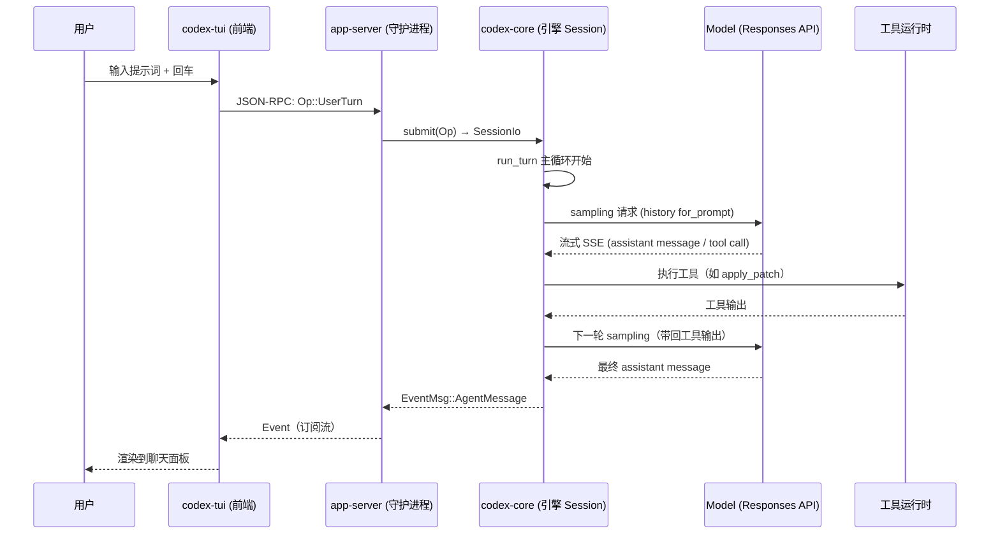

# 01 · 系统骨架：Codex CLI 进程与模块全景

> **一句话定位**：Codex CLI 是一个本地运行的编码智能体，核心是一个「模型响应流 + 工具执行 + 会话持久化」的主循环，外面包着 CLI/TUI/桌面/守护进程多层外壳。本文是形态A第一层——只回答「由什么进程组成、每个模块做什么、请求怎么走」，不深入第四层细节。

- 文档基线：`main @ 2cab11ca4`（2026-10-27，固定 Rust 1.95.0 的提交）
- 语言/工具链：Rust workspace（`codex-rs/`，edition 2024，122 个 crate），入口二进制多为 `arg0` 分发
- 相关文档：[[02-agent主循环]] · [[03-tui交互层]] · [[04-sandboxing沙箱]]

---

## 1. 进程全景

Codex 不是单进程，而是**一个交互前端 + 若干可选后台服务**的组合。按「用户会见到哪个进程」分四层：

```
┌───────────────────────────────────────────────────────────────┐
│  用户层进程（前端，用户直接启动/交互）                          │
│  codex            (cli)   交互 TUI，默认入口                    │
│  codex exec       (exec)  非交互一次跑                          │
│  codex app        (app)   Desktop 桌面壳（mac/win）             │
│  codex review / login / mcp / plugin / ...  其余子命令          │
└───────────────────────────────────────────────────────────────┘
                            │
┌───────────────────────────────────────────────────────────────┐
│  守护进程（后台，跨会话复用，JSON-RPC over WebSocket/UDS）      │
│  codex-app-server     共享 app-server，所有 agent 会话的宿主    │
│  codex exec-server    独立 exec 服务（非交互命令的沙箱宿主）    │
│  codex-app-server-daemon (库)  daemon 生命周期管理             │
└───────────────────────────────────────────────────────────────┘
                            │
┌───────────────────────────────────────────────────────────────┐
│  辅助可执行（独立进程，被沙箱/网络/语音等场景拉起）              │
│  codex-linux-sandbox  Linux bwrap/landlock 沙箱启动器           │
│  codex-network-proxy  托管网络代理（出网限流/审计）              │
│  codex-responses-api-proxy  Responses API 反向代理              │
│  codex-voice-host / codex-code-mode-host / codex-file-search    │
│  codex-stdio-to-uds   把 stdio 中继到 Unix socket               │
└────────────────────────────────────────────────────────────────┘
```

**关键事实**（全部经 Cargo.toml `[[bin]]` 与 `src/main.rs` 查证）：

| 可执行 | crate | 入口 | 角色 | 性质 |
|---|---|---|---|---|
| `codex` | `cli` | `cli/src/main.rs:120` | 总入口，子命令分派（见 §2） | 生产 |
| `codex-tui` | `tui` | `tui/src/main.rs` | 交互 TUI 主程序 | 生产 |
| `codex-exec` | `exec` | `exec/src/main.rs:32` | 非交互执行，arg0 可复用为 sandbox | 生产 |
| `codex-app-server` | `app-server` | `app-server/src/main.rs` | 共享会话守护进程 | 生产 |
| `codex-linux-sandbox` | `linux-sandbox` | `linux-sandbox/src/main.rs` | Linux 沙箱启动器 | 生产 |
| `bwrap` | `bwrap` | `bwrap/src/main.rs` | bubblewrap 封装 | 生产 |
| `codex-network-proxy` | `network-proxy` | `network-proxy/src/main.rs` | 托管网络代理 | 生产 |
| `apply_patch` | `apply-patch` | `apply-patch/src/main.rs` | 补丁应用工具 | 生产 |
| `codex-execpolicy` | `execpolicy` | `execpolicy/src/main.rs` | 执行策略检查 | 生产 |
| `codex-code-mode-host` | `code-mode-host` | `code-mode-host/src/main.rs` | code-mode 宿主 | 生产 |
| `codex-file-search` | `file-search` | `file-search/src/main.rs` | 文件搜索服务 | 生产 |
| `codex-responses-api-proxy` | `responses-api-proxy` | `responses-api-proxy/src/main.rs` | Responses API 代理 | 生产 |
| `codex-voice-host` | `voice-host` | `voice-host/src/main.rs` | 语音宿主 | 生产 |
| `codex-windows-sandbox-setup` | `windows-sandbox-rs` | `windows-sandbox-rs/src/bin/setup_main/main.rs` | Windows 沙箱 setup | 生产 |
| `codex-command-runner` | `windows-sandbox-rs` | `windows-sandbox-rs/src/bin/command_runner/main.rs` | Windows 受限命令执行器 | 生产 |
| `codex-windows-managed-deny-probe` | `windows-sandbox-rs` | `windows-sandbox-rs/src/bin/managed_deny_probe/main.rs` | Windows deny 探针 | 生产 |
| `codex-windows-sandbox-service` | `windows-sandbox-service` | `windows-sandbox-service/src/main.rs` | Windows 沙箱服务 | 生产 |
| `codex-stdio-to-uds` | `stdio-to-uds` | `stdio-to-uds/src/main.rs` | stdio↔UDS 中继 | 生产 |
| `codex-write-config-schema` | `config-schema` | `config-schema/src/main.rs` | 生成 `config.schema.json` fixture（开发/发布用） | 开发工具 |
| `codex-app-server-test-client` | `app-server-test-client` | `app-server-test-client/src/main.rs` | app-server 测试客户端（自动化测试用） | 开发工具 |
| `codex-thread-manager-sample` | `thread-manager-sample` | `thread-manager-sample/src/main.rs` | thread-manager 演示/调试样例 | 开发工具 |

> **计数**：生产可执行 **18** 个（含 windows-sandbox-rs 的 3 个 bin 逐个列名）+ 开发工具 **3** 个 = 共 **21** 个 `main.rs`。开发工具不随产品分发，排查时若在 `target/` 看到这三个二进制，可判定为构建产物而非运行时依赖。

纯库 crate（无独立可执行）：`core`、`protocol`、`config`、`sandboxing`、`app-server-daemon`、`app-server-transport`、`exec-server-protocol`、`app-server-protocol`、`tools`、`prompts`、`analytics` 等。

---

## 2. 顶层命令面（`codex` 的子命令）

`cli/src/main.rs:150` `enum Subcommand` 定义了全部子命令，按功能归类：

| 类别 | 子命令 | 说明 |
|---|---|---|
| **核心交互** | （无子命令） | 默认进入交互 TUI；`codex [PROMPT]` 直接带提示词 |
| | `exec` / `review` | 非交互一次执行 / 代码评审 |
| | `resume` / `fork` / `queue` | 恢复 / 分叉 / 排队消息到会话 |
| | `apply` | 应用 agent 产出的 diff |
| | `archive` / `delete` / `unarchive` | 会话归档 / 删除 / 反归档 |
| **登录与配置** | `login` / `logout` | 认证管理（浏览器/device-code/API key/access token） |
| | `doctor` | 诊断本地安装、配置、认证、运行时健康 |
| | `features` | 检查 feature 开关 |
| | `update` / `completion` | 自更新 / shell 补全 |
| **MCP 与插件** | `mcp` | 外部 MCP 服务器管理 |
| | `plugin` | Codex 插件管理 |
| **后台服务** | `app-server` | 实验性：跑 app-server 或相关工具 |
| | `remote-control` | app-server daemon 远程控制 |
| | `exec-server` | 独立 exec-server 服务 |
| | `cloud` | Codex Cloud 任务浏览 |
| | `app` | 桌面 app（mac/win） |
| **沙箱与调试** | `sandbox` | 在 Codex 沙箱内运行命令 |
| | `execpolicy` | 执行策略工具（隐藏） |
| | `debug` | 调试工具（models/app-server/prompt-input/trace-reduce/clear-memories） |
| | `migrate-rollouts` / `migrate-nfs-db` | 会话历史迁移 |
| **内部（隐藏）** | `tcp-tunnel` / `responses-api-proxy` / `stdio-to-uds` | 代理/隧道/中继 |

---

## 3. 模块划分（core 是引擎，其余是外壳）

`core/src/lib.rs` 声明的顶层模块是引擎本体，按职责归类：

```
codex-rs/core/src/
├── agent/         # agent 生命周期：注册表 registry、控制 control、角色 role、状态 status
│   ├── control/spawn.rs      (1110 行) 子 agent 生成
│   └── control/runtime.rs    ( 337 行) 运行时控制
├── session/       # 会话与主循环（最核心）
│   ├── mod.rs                (5731 行) Session 结构 + 会话生命周期
│   ├── turn.rs               (3488 行) run_turn 主循环 ← 见 02 专题
│   ├── session.rs / handlers.rs / input_queue.rs / mcp_runtime.rs
│   └── async_compaction.rs / context_window.rs / review.rs / rollout_budget.rs
├── codex_thread.rs  (1296 行) CodexThread：UI 看到的线程句柄
├── tools/         # 工具注册/路由/执行
│   ├── registry.rs / router.rs / runtimes/
│   └── handlers/  (apply_patch.rs, mcp.rs, ...)
├── config/        # 配置加载/权限/网络
├── context/ context_manager/   # 上下文片段管理
├── guardian/      # 安全护栏（审查/授权版本）
├── plugins/       # 插件
├── thread_manager/ # 线程/会话管理
├── state/ tasks/ unified_exec/ exec_policy/ hook_runtime/
├── sandboxing/ sandbox_tags.rs windows_sandbox.rs   # 沙箱衔接 ← 见 04 专题
└── apps/ prompts/ etc.
```

**外部 crate 分工**（引擎之外的支撑层）：

| crate | 职责 |
|---|---|
| `protocol` | 协议类型：`Op`/`Event`、`ResponseItem`、模型、配置类型 |
| `config` | 配置加载/合并/校验 |
| `sandboxing` | 跨平台沙箱封装（seatbelt/landlock/bwrap/windows/MXC） |
| `app-server-daemon` / `app-server-transport` | 守护进程与传输（UDS/stdio/websocket/remote-control） |
| `exec-server` / `exec-server-protocol` | 非交互执行服务与协议 |
| `mcp` / `codex-mcp` | MCP 客户端/服务器 |
| `models-manager` / `model-provider*` | 模型目录与提供方 |
| `prompts` | 提示词模板 |
| `analytics` / `otel` | 埋点与可观测 |
| `apply-patch` | 补丁应用 |

---

## 4. 主数据流：一次交互从按键到模型响应

以交互模式（`codex` 无子命令）为例，一次典型用户输入走完全程：



**关键传输通道**（Explore 查证，见 `app-server-transport/src/transport/`）：

- **UDS**（`unix_socket.rs`，WebSocket 升级）—— 本机默认，mac/linux
- **stdio**（`stdio.rs`）—— 无 UDS 环境降级
- **websocket**（`websocket.rs`）—— 远程/云端
- **remote-control**（`remote_control/`）—— daemon 远程控制面

协议为 **JSON-RPC over WebSocket**，消息体是 `Op`（UI→Codex）与 `Event`/`EventMsg`（Codex→UI），均为 `non_exhaustive` 枚举（`protocol/src/protocol.rs`，详见 `docs/protocol_v1.md`）。

> 注意：`codex exec`（非交互）与交互模式走不同通道——exec 直接驱动 `exec-server` 客户端（`exec-server/src/client/`），用 `ws://` 连独立 exec-server，而不是 app-server。这是「一个引擎、两种宿主」的架构。

---

## 5. 已知缺口 / 待拍板

| 级别 | 结论 | 依据 |
|---|---|---|
| P3 | `codex-tui` 与 `codex` 是同一套 TUI 的两层包装：`cli` 里 `interactive: TuiCli`（`main.rs:143`），`tui` crate 自带 `main.rs`。两处入口并存，属历史分层产物 | `main.rs:143`、`tui/src/main.rs` |
| P3 | `codex exec` 入口用 `arg0_dispatch_or_else`（`exec/src/main.rs:33`），同一二进制可被 `execve` 以不同 argv[0] 复用为 sandbox——沙箱可执行名与主程序同源，排查时先看 argv[0] | `exec/src/main.rs:33` |
