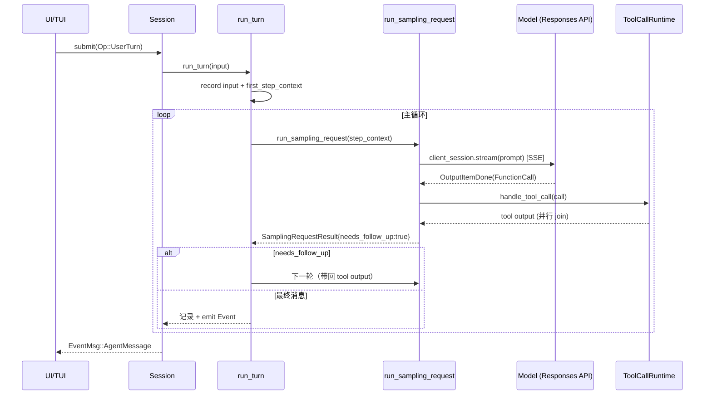

# 02 · Agent 主循环：`run_turn` 从输入到回复

> **一句话定位**：Agent 主循环是 Codex 引擎的核心——一次「用户输入 → 模型回复 → 可能多次工具调用 → 最终回复」的完整回合（turn）。它住在 `codex-rs/core/src/session/`，由 `run_turn`（turn.rs）驱动，内部靠 `try_run_sampling_request`（turn.rs）做「请求模型 + 执行工具」的往返。本文是形态B专题，用骨架 D（顺序深潜）讲透这条链路。

- 文档基线：`main @ 2cab11ca4`（2026-10-27）
- 相关文档：[[01-系统骨架]] · [[03-tui交互层]] · [[04-sandboxing沙箱]]
- 边界澄清：**turn ≠ task ≠ session**。turn 是单次模型往返；task 是一次用户输入（可含多 turn）；session/thread 是持久化会话（可含多 task）。本专题只讲 turn。

---

## 1. 总览：turn 的生命周期

```
用户输入 TurnInput[]
   │
   ▼
run_turn(sess, turn_context, input, ...)        turn.rs:174
   │
   ├─ 1. pre-turn 压缩 / 记录输入 / 构建 first_step_context
   ├─ 2. loop {                                   ← 主循环（turn.rs:473）
   │       ├─ 捕获 pending_input（用户中途插话）
   │       ├─ capture_step_context（工具/上下文快照）
   │       ├─ run_sampling_request(...)            turn.rs:1735
   │       │     └─ loop {                         ← 采样内部循环（turn.rs:1778）
   │       │          ├─ build_prompt（历史 for_prompt）
   │       │          ├─ try_run_sampling_request   turn.rs:2662
   │       │          │     ├─ client_session.stream(...)  ← Responses API 流
   │       │          │     └─ for each OutputItemDone:
   │       │          │          ├─ FunctionCall → ToolCallRuntime.handle_tool_call (并行)
   │       │          │          └─ assistant msg → 记录/发 Event
   │       │          └─ 重试逻辑 handle_response_stream_error
   │       └─ needs_follow_up ? continue : break
   │     }
   └─ 3. stop hooks / after-agent hook / 汇总
```

**核心不变量**：`needs_follow_up`（`SamplingRequestResult`，turn.rs:2012）决定主循环是否继续。只要模型请求了工具调用（FunctionCall），或用户插话（pending_input），就置 true 继续下一轮；只有模型给出最终 assistant 消息且无 pending input，才 false 跳出。

---

## 2. 入口：`run_turn`（turn.rs:174）

```rust
pub(crate) async fn run_turn(
    sess: Arc<Session>,
    turn_context: Arc<TurnContext>,
    mut input: Vec<TurnInput>,
    mcp_startup_requirements: &mut McpStartupRequirements,
    prewarmed_client_session: Option<ModelClientSession>,
    cancellation_token: CancellationToken,
) -> CodexResult<Option<String>>
```

签名要点（`run_turn` 偏移 +0~+7）：

| 参数 | 含义 |
|---|---|
| `sess: Arc<Session>` | 整个会话（线程）的宿主，持全部服务 |
| `turn_context: Arc<TurnContext>` | 本次 turn 的上下文：模型信息、审批策略、沙箱策略、环境选择 |
| `input: Vec<TurnInput>` | 本次 turn 的输入（用户消息/响应项） |
| `prewarmed_client_session` | 可选：启动预热的模型会话（跨 turn 复用 WebSocket） |
| `cancellation_token` | 取消令牌（用户 Ctrl-C / 中断） |

返回 `CodexResult<Option<String>>`：`Ok(Some(last_agent_message))` = 正常完成；`Ok(None)` = 被 hook 拦截/压缩后放弃；`Err` = 失败。

### 2.1 turn 前的三件事（turn.rs:182~241）

1. **auto_compaction 决定**：`thread_extension_data` 里是否有 `AutoCompactionDisabled`（`turn.rs:182`），没有则开自动压缩；`auto_summarization_enabled` 再叠加 `TokenBudget` feature 判断。
2. **Guardian 待决输入检查**：基本会话源才走 `check_pending_guardian_input`（turn.rs:190）。
3. **drain 上一 turn 的异步 hook 结果**：`drain_async_hook_results(before_user_prompt=true)`（turn.rs:193）。
4. **pre-turn 压缩**：`run_pre_sampling_compact`（turn.rs:202）——在记录新用户输入前，若上下文将超阈值就提前压缩。

### 2.2 记录输入与构建首步上下文（turn.rs:243~339）

- `turn_user_input(&input)`（turn.rs:1005）把 `TurnInput` 拆成纯用户输入。
- `required_mcp_servers_for_input`（turn.rs:253）收集输入提到的 MCP server，`required_servers` 去重排序。
- `capture_step_context_with_required_mcp_servers`（turn.rs:277）构建 `first_step_context`——这是本轮的工具/上下文快照，`StepContext` 包含 `tool_router`、`settings.model_info`、`environments`、`turn`。
- `record_context_updates_and_set_reference_context_item`（turn.rs:302）+ `turn_diff_display_roots`（turn.rs:323）并行——前者记录上下文、后者算 diff 显示根。
- `build_skills_and_plugins`（turn.rs:329）：注入 skills 与 plugins 到首步上下文。

---

## 3. 主循环（turn.rs:473 `loop`）

每次迭代（`run_turn` 偏移 +299 起）：

```rust
loop {
    // 3.1 用户中途插话
    let pending_input = if can_drain_pending_input {
        sess.input_queue.get_pending_input(&sess.active_turn).await.0
    } else { Vec::new() };

    // 3.2 记录插话
    if run_hooks_and_record_inputs(...PersistContext::SteeredUserInput).await { break; }

    // 3.3 构建本轮 step_context（无 pending 则复用，有则重新 capture）
    let step_context = match next_step_context.take() { ... };

    // 3.4 发起采样（请求模型 + 执行工具，见 §4）
    let sampling_request_result = run_sampling_request(...).await;

    // 3.5 根据结果决定是否继续
    match sampling_request_result {
        Ok((output, input)) => {
            let needs_follow_up = output.needs_follow_up || has_pending_input;
            if !needs_follow_up {
                // 停 hook / after-agent hook
                if stop_outcome.should_stop { break; }   // turn.rs:783
                ...
            }
        }
        ...
    }
}
```

**三个退出点**：

| 退出点 | 位置 | 条件 |
|---|---|---|
| `break` | turn.rs:784 | stop hook 要求停，或模型不再需要 follow-up |
| `return Ok(None)` | 多处 | hook 拦截 / 压缩后放弃 / 会话被中止 |
| `return Err(err)` | 多处 | 失败（TurnAborted / ContextWindowExceeded / 等） |

**压缩（roll-over）**：`should_roll_over`（turn.rs:677）= auto_compaction && needs_follow_up &&（new_context_window_request || token_limit_reached || candidate）。为真时 `run_auto_compact`（turn.rs:695）在 turn 中途压缩，成功后 `continue` 下一轮。

---

## 4. 采样请求：`run_sampling_request`（turn.rs:1735）

```rust
async fn run_sampling_request(
    sess: Arc<Session>,
    step_context: Arc<StepContext>,
    turn_store: Arc<ExtensionData>,
    turn_diff_tracker: SharedTurnDiffTracker,
    client_session: &mut ModelClientSession,
    input: Vec<ResponseItem>,
    cancellation_token: CancellationToken,
) -> CodexResult<(SamplingRequestResult, Vec<ResponseItem>)>
```

### 4.1 准备（turn.rs:1744~1777）

- `ToolCallRuntime::new`（turn.rs:1755）：本轮的工具执行运行时，封装 `session`+`step_context`+`diff_tracker`。
- `stream_max_retries`（turn.rs:1765）：从 provider 拿最大重试数。
- `responses_stream_retry_state`：本轮的重试状态机。

### 4.2 采样内部循环（turn.rs:1778 `loop`）

每次迭代（`run_sampling_request` 偏移 +43 起）：

1. **构建 prompt**：`sess.clone_history().for_prompt(...)`（turn.rs:1784）拿历史，`build_prompt(prompt_input, step_context, base_instructions, incremental_tools)`（turn.rs:1792）。
2. **Guardian 准备 prompt**：`prepare_guardian_prompt`（turn.rs:1802）——仅基本会话源。
3. **try_run_sampling_request**（turn.rs:1811）：真正的流式往返，见 §5。
4. **错误处理**（turn.rs:1828~1841）：`ContextWindowExceeded` → 标满 token；`UsageLimitReached` → 更新速率限制；其余 → `handle_response_stream_error`（turn.rs:1846）重试。
5. **成功**：返回 `(output, original_input)`（turn.rs:1826）。

---

## 5. 流式往返：`try_run_sampling_request`（turn.rs:2662）

这是「一次模型请求」的完整执行，**内部又一个 `loop`**（turn.rs:2784 附近）逐个消费流式事件。

### 5.1 请求前（turn.rs:2662~2780）

- `feedback_tags!`（turn.rs:2675）：埋点标签（model/approval_policy/sandbox_policy/effort/auth_mode）。
- 记录 `inference_trace`（turn.rs:2688）。
- **hooks 三连**：`PreModelRequest`（turn.rs:2741，同步）、`PostModelRequest`（turn.rs:2713，异步 oneshot 注册 `finish_post_request`）、`execution_mode` 决定 `defer_tool_dispatch`（turn.rs:2714）——defer 模式下工具派发被推迟到 post hook 完成后。
- `client_session.stream(...)`（turn.rs:2752）：真正的 **Responses API 流式请求**，`.or_cancel(&cancellation_token)`。

### 5.2 流式事件消费（turn.rs:2829 起）

```rust
let event = stream.next()...await;   // 下一个 SSE 事件
match event {
    ResponseEvent::Created { response_id } => { /* 记录 response_id */ }
    ResponseEvent::OutputItemDone(item) => {
        // 5.3 见下：分派工具 / 记录消息
        let output_result = handle_output_item_done(&mut ctx, item, ...).await;
        if let Some(tool_future) = output_result.tool_future {
            in_flight.push_back(tool_future);      // 并行执行队列
        }
        needs_follow_up |= output_result.needs_follow_up;
    }
    ResponseEvent::Completed { .. } => break,
    ...
}
```

**并发工具执行**：`in_flight`（`Vec<InFlightFuture>`）累积每个 `FunctionCall` 的 `tool_future`，全部 `join!` 后统一回写——这就是「一个采样请求里多个工具并行」的实现。

### 5.3 工具分派：`handle_output_item_done`（`core/src/stream_events_utils.rs`）

`FunctionCall` 分支（`core/src/stream_events_utils.rs:355~370`）核心：

```rust
let tool_future: InFlightFuture<'static> = if ctx.defer_tool_dispatch {
    Box::pin(async move {
        if cancellation_token.is_cancelled() {
            return Ok(ToolCallRuntime::aborted_response(&call, None).into_response());
        }
        runtime.handle_tool_call(call, cancellation_token).await
    })
} else {
    Box::pin(runtime.handle_tool_call(call, cancellation_token))
};
output.needs_follow_up = true;
output.tool_future = Some(tool_future);
```

- **`needs_follow_up = true`**（`core/src/stream_events_utils.rs:369`）：只要有工具调用，就必须下一轮采样把结果回传模型。
- **`handle_tool_call`**（`tools/parallel.rs:107`）：工具真正执行入口，`parallel_execution: RwLock`（`parallel.rs:92`）保证并发互斥。

**非工具消息**分支（`core/src/stream_events_utils.rs:373~411`）：assistant 消息 → `finalize_non_tool_response_item` → `emit_turn_item_started/completed`（发 `Event` 给 UI）。这就是「模型只说回复时 turn 结束」的路径。

---

## 6. 模型回复的两种结局

| 模型返回 | 引擎动作 | needs_follow_up |
|---|---|---|
| `FunctionCall`（要执行工具） | `handle_tool_call` 并行执行，结果写入 `FunctionCallOutput` 回传 | **true** → 继续循环 |
| 纯 assistant `Message` | `finalize_non_tool_response_item` → `emit_turn_item_completed` | false → 循环跳出 |

工具执行失败的两条路（`core/src/stream_events_utils.rs:413~456`）：
- `RespondToModel(message)`：直接以文本 `FunctionCallOutput` 回传模型（turn.rs 外，`core/src/stream_events_utils.rs:418`）。
- `Fatal(message)`：以 `success: false` 的 output 回传。

---

## 7. 时序图（一次含工具调用的 turn）



---

## 8. 关键源码索引

| 符号 | 文件:函数 | 绝对行 |
|---|---|---|
| `run_turn` | `core/src/session/turn.rs:run_turn` | 174 |
| 主循环 `loop` | `core/src/session/turn.rs:run_turn` | 473 |
| `run_sampling_request` | `core/src/session/turn.rs:run_sampling_request` | 1735 |
| 采样内部 `loop` | `core/src/session/turn.rs:run_sampling_request` | 1778 |
| `try_run_sampling_request` | `core/src/session/turn.rs:try_run_sampling_request` | 2662 |
| 流式消费 `loop` | `core/src/session/turn.rs:try_run_sampling_request` | 2784 |
| `handle_output_item_done` | `core/src/stream_events_utils.rs:handle_output_item_done` | 317 |
| `handle_tool_call` | `core/src/tools/parallel.rs:handle_tool_call` | 107 |
| `ToolCallRuntime` 结构 | `core/src/tools/parallel.rs:ToolCallRuntime` | 49 |
| `SamplingRequestResult` | `core/src/session/turn.rs:SamplingRequestResult` | 2012 |

---

## 9. 已知缺口 / 待拍板

| 级别 | 结论 | 依据 |
|---|---|---|
| P2 | 工具执行失败时 `RespondToModel` 直接把文本回传模型，**不经过审批/沙箱**（`core/src/stream_events_utils.rs:413`）——若该错误文本由工具自身构造，理论上可被模型利用，实际风险低但值得复核 | `core/src/stream_events_utils.rs:413` |
| P3 | `defer_tool_dispatch`（post hook 为 Sync 时）会推迟所有工具派发到 post hook 后，`handle_tool_call` 在 future 里被 `or_cancel`——并发窗口里工具可能在取消后仍启动（cancellation_token 检查在派发前） | `core/src/stream_events_utils.rs:355`、`turn.rs:2714` |
| P3 | `run_turn` 有多处 `return Ok(None)`（压缩/拦截后放弃），调用方需区分「正常完成」与「被放弃」——语义靠 `Option` 表达，容易误判 | `turn.rs:240~794`（7 处：240/338/342/396/708/731/794） |
