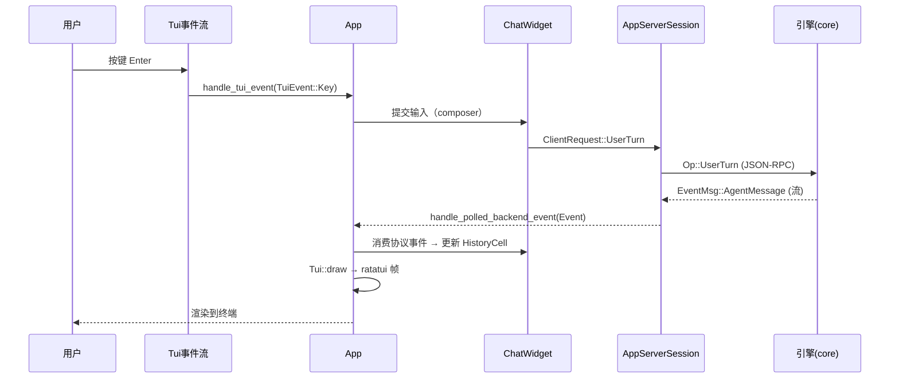

# 03 · TUI 交互层：事件循环与渲染

> **一句话定位**：TUI 是 Codex 的交互前端，跑在 `codex-rs/tui/`，用 ratatui + crossterm 绘制。它不直接执行模型/工具，而是连 app-server 守护进程，通过 JSON-RPC over WebSocket 收发 `Op`/`Event`，把 agent 的 turn 流渲染成聊天界面。本文是形态B专题，用骨架 D（顺序深潜）讲透「入口 → 主事件循环 → 事件分派 → 渲染 → 安全块机制」。

- 文档基线：`main @ 2cab11ca4`（2026-10-27）
- 相关文档：[[01-系统骨架]] · [[02-agent主循环]] · [[04-sandboxing沙箱]]
- 边界澄清：**TUI ≠ 引擎**。TUI 只是前端壳，真正的主循环在 `core/session`（见 02 专题）。TUI 的主循环是「UI 事件循环」，消费终端按键 + app-server 事件流。

---

## 1. 总览：TUI 与引擎的边界

```
┌──────────────────────── TUI (codex-rs/tui) ───────────────────────┐
│ run_main → startup_orchestration → App::run                      │
│    │                                                             │
│    ├─ tui_events (终端按键/粘贴/鼠标)  ──┐                        │
│    ├─ app_event_rx (内部异步任务)        ├─ select! 主循环        │
│    ├─ active_thread_rx (活跃线程事件)    │  (startup.rs:1427)     │
│    └─ backends.next_event (app-server) ─┘                        │
└───────────────────────────┬───────────────────────────────────────┘
                            │ JSON-RPC over WebSocket (UDS/stdio/ws)
┌───────────────────────────▼───────────────────────────────────────┐
│ AppServerSession (app_server_session.rs)                           │
│   ClientRequest::ThreadStart / UserTurn / ...                     │
└───────────────────────────┬───────────────────────────────────────┘
                            │
┌───────────────────────────▼───────────────────────────────────────┐
│ app-server (守护进程) → core/session (run_turn)  ← 02 专题         │
└───────────────────────────────────────────────────────────────────┘
```

**核心不变量**：TUI 通过 `AppServerSession` 单向提交请求、异步收 `Event` 流，本地 `App` 状态机只反映已收到的事件——TUI 从不主动改引擎状态。

---

## 2. 入口：`run_main` → `run_ratatui_app`

### 2.1 `run_main`（lib.rs:1145）

```rust
pub async fn run_main(cli, arg0_paths, loader_overrides, explicit_remote_endpoint)
    -> std::io::Result<AppExitInfo>
```

- 初始化 `system_motion`（lib.rs:1151）。
- `startup_recovery::scope`（lib.rs:1152）包裹整个会话——异常恢复。
- `startup_orchestration::run_main_inner`（lib.rs:1155）在 `Box::pin` 里跑，避免大 future 占栈。
- 退出时若 `Fatal` 先 `restore_terminal_before_fatal_exit`（lib.rs:1172）。

### 2.2 `run_ratatui_app`（lib.rs:1186）

`color_eyre::install`（lib.rs:1214）、panic hook 转发到 tracing 并恢复终端（lib.rs:1222~1227）。之后进入 `App::run`（app/startup.rs:232）。

---

## 3. 主事件循环：`App::run` 的 `select!`（startup.rs:1427）

TUI 的核心是 `loop`（startup.rs:1282）+ `tokio::select!`（startup.rs:1427），**六个分支**并发等待：

| 分支 | 来源 | 处理 | 位置 |
|---|---|---|---|
| ① daemon_restart | `app.daemon_restart` 后台任务 | 重启后台服务器 | startup.rs:1429 |
| ② app_event | `app_event_rx.recv()` | `app.handle_event(...)` | startup.rs:1440 |
| ③ active_thread | `active_thread_rx.recv()` | `app.handle_active_thread_event(...)` | startup.rs:1465 |
| ④ tui_event | `tui_events.next()` | `app.handle_tui_event(...)` | startup.rs:1484 |
| ⑤ backend_event | `backends.next_event(paused)` | `app.handle_polled_backend_event(...)` | startup.rs:1517 |
| ⑥ reconnect | 重连 future | `app.finish_reconnect(...)` | startup.rs:1538 |

**分支优先级逻辑**（startup.rs:1471~1484 的 guard）：
- `active_thread` 分支仅在 `waiting_for_initial_session_configured` 为 false、`has_pending_app_events` 为 false、非离线时启用。
- `tui_event` 分支在 `pending_thread_switch_resets == 0` 且（离线或 `!block_terminal_input_for_pending_startup_events`）时启用——**启动保护**：某些 pending 事件期间屏蔽终端输入，避免用户按键在会话未就绪时丢失（startup.rs:1505）。

**事件处理公共出口**（`AppRunControl`）：每分支返回 `Continue` 或 `Exit(reason)`；transport 错误统一走 `app.recover_transport_error`（startup.rs:1461/1509），返回 `Continue` 表示已恢复。

---

## 4. 事件分派：`handle_tui_event`（app.rs:863）

处理一个终端事件，返回 `Result<AppRunControl>`。按序（app.rs:869~952）：

```rust
tui.link_hover.observe(&event);                    // 链接悬停
self.refresh_link_hover(tui)?;
self.invalidate_right_click_paste(&event);         // 右键粘贴失效
self.finish_clipboard(tui, &event);
let event = self.finish_right_click_paste(tui, event);

if self.startup_protected_input_boundary && ... {  // 启动保护：丢弃弹窗输入
    self.discard_startup_modal_input(tui)?;
    return Ok(AppRunControl::Continue);
}
if matches!(&event, TuiEvent::Key(key) if key.kind != KeyEventKind::Release) { ... }
// backtrack 选择退出键
if self.handle_rendered_selection_event(tui, &event)? { return ...; }
// composer 复制事件
if ... && self.handle_composer_copy_event(...) { return ...; }
// 离线 Ctrl-C/Ctrl-D 退出
if self.reconnect.offline && ... { return Ok(AppRunControl::Exit(UserRequested)); }
// ... 继续分发给 chat_widget / overlay / transcript
```

**关键点**：
- `TuiEvent` 有三种：`Key` / `Paste` / `Mouse` / `Draw` / `Resume`（app.rs:891 用 `matches!(event, TuiEvent::Draw)` 判定空闲绘制帧）。
- 事件先做 UI 级预处理（悬停/剪贴板/backtrack），再交给 `chat_widget` 或 `overlay`。
- `KeyEventKind::Release` 通常被过滤，避免长按重复触发。

---

## 5. 渲染模型：committed cells vs active cell

`ChatWidget`（chatwidget.rs 顶部模块文档）采用「两态渲染」：

| 状态 | 含义 | 行为 |
|---|---|---|
| **committed transcript cells** | 已完成的 `HistoryCell` | 渲染为最终文本，不再变化 |
| **active cell**（`ChatWidget.active_cell`） | 流式 in-flight 内容 | 流式工具输出/assistant 消息可原地 mutate |

- 主视口渲染 committed cells + 当前 active cell。
- **transcript overlay（Ctrl+T）**：渲染 committed cells + 缓存只读 live tail（从 active cell 派生），用 `active_cell_transcript_key()` / `active_cell_transcript_hyperlink_lines()` 做缓存键（chatwidget.rs 顶部文档）——当 active cell 原地 mutate 或时间相关输出变化时刷新缓存 tail。
- `Tui::draw`（tui.rs:1289）/ `draw_with_resize_reflow`（tui.rs:1442）是底层绘制入口。

**渲染数据流**：

```
app-server Event ──▶ App::handle_polled_backend_event
                     └─▶ ChatWidget 消费协议事件
                          ├─ 构建/更新 HistoryCell（committed）
                          └─ mutate active_cell（in-flight）
                     ──▶ Tui::draw → ratatui 帧
```

---

## 6. 安全块机制：`safety_recourse`（app/safety_recourse.rs）

这是近期焦点（#57365「Offer safer rewrites after safety blocks in the TUI」）。模型被安全策略 block 后，TUI 提供「更安全改写」（safer rewrite）选项，在 **verified fork** 上重跑。

### 6.1 能力探测（safety_recourse.rs:9 `supports_server`）

```rust
pub(super) fn supports_server(app_server: &AppServerSession) -> bool {
    let minimum = semver::Version::new(0, 151, 0);   // 服务器版本门槛
    let Some(version) = app_server.server_version() else {
        return app_server.uses_embedded_app_server();
    };
    semver::Version::parse(version).is_ok_and(|version| version >= minimum)
}
```

- 低于 0.151.0 的远程服务器**静默忽略**所需 turn trigger → 必须探测版本。
- 无版本信息时仅嵌入式 app-server 支持。

### 6.2 提交改写（safety_recourse.rs:18 `continue_with_rewrite`）

前置守卫（safety_recourse.rs:26~34）：

```rust
if !supports_server(app_server)
    || app.active_thread_id != Some(thread_id)      // 必须是活跃主线程
    || app.primary_thread_id != Some(thread_id)     // 必须是非子 agent 的 primary
    || app.chat_widget.last_turn_id() != Some(turn_id.as_str())
    || app.chat_widget.is_user_turn_pending_or_running()
    || app.chat_widget.has_queued_follow_up_messages()
{ return; }   // 静默放弃——不满足条件就不提供改写
```

随后（safety_recourse.rs:59~70）：
- `fork_thread_at(..., before_turn_id: Some(turn_id), ForkGoalContinuation::StartIfIdle, ...)`——在被 block 的 turn **之前**分叉，保留原草稿。
- `prepare_safety_recourse_rewrite(&prompt)`（safety_recourse.rs:107）——标记新 turn 为 `safety_recourse_follow_up`。
- 过滤可能调用命令/skills/apps/plugins 的建议（`chatwidget/safety_recourse/metadata.rs`）。

### 6.3 建议解析（chatwidget/safety_recourse/metadata.rs）

`parse(value) -> Option<(Domain, Option<Recourse>)>`（metadata.rs:53）：从安全块消息解析 `Recourse { explanation, suggestions }`。`Domain` 枚举（metadata.rs:9）区分来源域。`valid_text`（metadata.rs:185）做文本校验。

---

## 7. 时序图（一次用户输入到渲染）



---

## 8. 关键源码索引

| 符号 | 文件:函数 | 绝对行 |
|---|---|---|
| `run_main` | `tui/src/lib.rs:run_main` | 1145 |
| `run_ratatui_app` | `tui/src/lib.rs:run_ratatui_app` | 1186 |
| `App::run` | `tui/src/app/startup.rs:run` | 232 |
| 主事件 `loop` | `tui/src/app/startup.rs:run` | 1282 |
| 主 `select!` | `tui/src/app/startup.rs:run` | 1427 |
| `handle_tui_event` | `tui/src/app.rs:handle_tui_event` | 863 |
| `Tui::draw` | `tui/src/tui.rs:draw` | 1289 |
| `supports_server` | `tui/src/app/safety_recourse.rs:supports_server` | 9 |
| `continue_with_rewrite` | `tui/src/app/safety_recourse.rs:continue_with_rewrite` | 18 |
| `parse` | `tui/src/chatwidget/safety_recourse/metadata.rs:parse` | 53 |

---

## 9. 设计特性与值得关注的点

| 要点 | 结论 | 依据 |
|---|---|---|
| 静默禁用 | `safety_recourse` 对 <0.151.0 的远程服务器**静默禁用**——用户可能完全看不到「更安全改写」选项却无提示（`supports_server` 返回 false 直接 `return`） | `codex-rs/tui/src/app/safety_recourse.rs:9~16` |
| 静默放弃 | `continue_with_rewrite` 的守卫是**静默放弃**（不满足条件直接 return，无 UI 反馈）——若因 `is_user_turn_pending_or_running` 等瞬态条件失败，用户点了没反应 | `codex-rs/tui/src/app/safety_recourse.rs:26~34` |
| 启动保护分散 | TUI 主循环 6 个 select! 分支里，`tui_event` 与 `backend_event` 优先级靠 guard 表达式调节，启动保护边界（`startup_protected_input_boundary`）的判定条件分散在 app.rs 与 startup.rs 两处，改动易漏 | `codex-rs/tui/src/startup.rs:1471~1505` |
