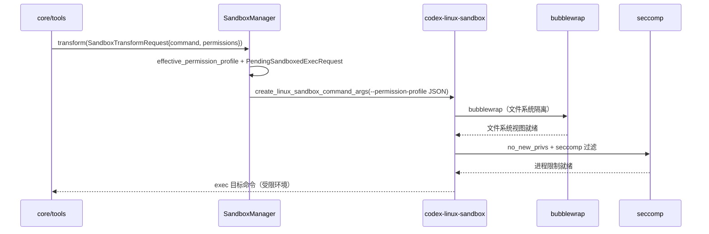

# 04 · Sandboxing 沙箱：跨平台权限隔离

> **一句话定位**：沙箱是 Codex 执行不可信工具命令（`exec_command`、`apply_patch`、shell 等）时的权限隔离层。入口是 `codex-rs/sandboxing/` 的 `SandboxManager`，按平台选后端：macOS→Seatbelt、Linux→bubblewrap+seccomp（或 legacy landlock）、Windows→RestrictedToken / MXC。本文是形态B专题，用骨架 C（机制横切）讲透「策略 → 后端选择 → 命令变换 → 启动」。

- 文档基线：`main @ 2cab11ca4`（2026-10-27）
- 相关文档：[[01-系统骨架]] · [[02-agent主循环]] · [[03-tui交互层]]
- 边界澄清：**`sandboxing`（crate）是策略与封装层；`linux-sandbox`（crate）是 Linux 后端实际启动器**。前者把 `PermissionProfile` 变换成 CLI 参数，后者解析参数并真正 bwrap/seccomp。

---

## 1. 总览：策略 → 后端 → 启动

```
PermissionProfile (protocol 模型)
   │  to_runtime_permissions() → FileSystemSandboxPolicy + NetworkSandboxPolicy
   ▼
SandboxManager (sandboxing/src/manager.rs)
   ├─ should_sandbox()        是否要沙箱（Forbid/Require/Auto）
   ├─ select_initial()        按平台选 SandboxType
   ├─ transform()             把命令包装成带沙箱的启动请求
   └─ transform_for_direct_spawn()  直接 spawn 变体
   ▼
SandboxType::MacosSeatbelt / LinuxSeccomp / WindowsRestrictedToken / WindowsMxc / None
   ▼
codex-linux-sandbox (linux-sandbox/src/linux_run_main.rs:135 run_main)
   ├─ bubblewrap（文件系统隔离）
   └─ seccomp（系统调用过滤 + no_new_privs）
```

---

## 2. 三态偏好：`SandboxablePreference`（manager.rs:44）

```rust
pub enum SandboxablePreference { Auto, Require, Forbid }
```

### 2.1 `should_sandbox`（manager.rs:334）

```rust
pub fn should_sandbox(&self, permission_profile, pref, has_managed_network_requirements) -> bool {
    match pref {
        Forbid => false,
        Require => true,
        Auto => {
            let (file_system_policy, network_policy) = permission_profile.to_runtime_permissions();
            should_require_platform_sandbox(&file_system_policy, network_policy, has_managed_network_requirements)
        }
    }
}
```

| 偏好 | 语义 | 结果 |
|---|---|---|
| `Forbid` | 明确禁止沙箱 | **false**（不沙箱，哪怕 Require 场景） |
| `Require` | 强制沙箱 | **true** |
| `Auto` | 按策略自动判定 | 取决于 `should_require_platform_sandbox`（文件系统策略 + 网络策略 + 托管网络要求） |

> 注意：`Forbid` 是最高优先级——即使系统需要沙箱（如托管网络），也直接 false。

### 2.2 `select_initial`（manager.rs:313）

```rust
pub fn select_initial(&self, permission_profile, pref, windows_sandbox_type, has_managed_network_requirements) -> SandboxType {
    if !self.should_sandbox(...) { return SandboxType::None; }
    if cfg!(windows) && windows_sandbox_type == SandboxType::WindowsMxc {
        return SandboxType::WindowsMxc;
    }
    get_platform_sandbox(windows_sandbox_type != SandboxType::None).unwrap_or(SandboxType::None)
}
```

- Windows 上若指定 MXC 类型则优先 MXC。
- 否则 `get_platform_sandbox`（manager.rs:50）按平台给默认后端。

---

## 3. 平台后端选择：`get_platform_sandbox`（manager.rs:50）

```rust
pub fn get_platform_sandbox(windows_sandbox_enabled: bool) -> Option<SandboxType> {
    if cfg!(target_os = "macos") { Some(SandboxType::MacosSeatbelt) }
    else if cfg!(target_os = "linux") { Some(SandboxType::LinuxSeccomp) }
    else if cfg!(target_os = "windows") {
        if windows_sandbox_enabled { Some(SandboxType::WindowsRestrictedToken) } else { None }
    } else { None }
}
```

| 平台 | 后端 | 说明 |
|---|---|---|
| macOS | `MacosSeatbelt` | Seatbelt profile（`.sbpl` 文件，见 sandboxing/src/seatbelt*.sbpl） |
| Linux | `LinuxSeccomp` | bubblewrap + seccomp（见 §5） |
| Windows | `WindowsRestrictedToken` | 受限令牌（仅当 `windows_sandbox_enabled`） |
| Windows | `WindowsMxc` | 微软 MXC（需 `codex_mxc_sandbox::is_available()`） |
| 其它 | `None` | 无沙箱 |

---

## 4. 命令变换：`transform`（manager.rs:355）

`transform(request: SandboxTransformRequest)` → `Result<SandboxExecRequest>`。核心流程：

1. **合并额外权限**：`effective_permission_profile(permissions, additional_permissions)`（manager.rs:376）。
2. **构造 pending 请求**：`PendingSandboxedExecRequest::new(&command.cwd, sandbox_policy_cwd, base_profile, mitm_ca_path)`（manager.rs:378）——把 Profile 与 cwd 提前绑定。
3. **按 `sandbox` 分支**（manager.rs:388 `match sandbox`）：
   - `SandboxType::None` → 原样 argv。
   - `SandboxType::WindowsMxc` → `create_command_args`（manager.rs:423），要求 `sandbox_exe`（Codex 可执行路径），托管网络走 `prepare_for_optional_environment`。
   - `SandboxType::MacosSeatbelt`（manager.rs:437）→ `create_seatbelt_command_args_with_profile`，从 `effective_permission_profile.to_runtime_permissions()` 取文件系统/网络策略。
   - Linux 分支 → `create_linux_sandbox_command_args_for_permission_profile`（landlock.rs:26）。

### 4.1 macOS Seatbelt（manager.rs:437~452）

```rust
let (file_system_sandbox_policy, network_sandbox_policy) = pending.effective_permission_profile.to_runtime_permissions();
let mut args = create_seatbelt_command_args_with_profile(CreateSeatbeltCommandArgsParams {
    command: argv,
    file_system_sandbox_policy: &file_system_sandbox_policy,
    network_sandbox_policy,
    sandbox_policy_cwd: pending.native_sandbox_policy_cwd.as_path(),
    ...
});
```

- Seatbelt profile 由 `.sbpl` 模板 + 运行时文件系统/网络策略合成（`seatbelt.rs`，1125 行）。
- 托管网络时请求 proxy-only 网络。

---

## 5. Linux：bubblewrap vs legacy landlock（landlock.rs + linux_run_main.rs）

### 5.1 后端决定（manager.rs:802 `ensure_linux_bubblewrap_is_supported`）

```rust
let requires_bubblewrap = allow_network_for_proxy
    || (!use_legacy_landlock && !file_system_sandbox_policy.has_full_disk_write_access());
if is_wsl1 && requires_bubblewrap {
    return Err(SandboxTransformError::Wsl1UnsupportedForBubblewrap);
}
```

| 条件 | 需要 bubblewrap？ |
|---|---|
| 托管网络要求（`allow_network_for_proxy`） | **是**（需要隔离网络命名空间） |
| 非 legacy landlock 且非全盘写权限 | **是** |
| legacy landlock + 全盘写权限 | 否（可用 landlock） |
| WSL1 + 需要 bubblewrap | **报错** `Wsl1UnsupportedForBubblewrap` |

### 5.2 CLI 参数（landlock.rs:26 `create_linux_sandbox_command_args_for_permission_profile`）

```rust
let mut linux_cmd = vec![
    "--sandbox-policy-cwd", sandbox_policy_cwd,
    "--command-cwd", command_cwd,
    "--permission-profile", permission_profile_json,   // 完整 Profile 序列化成 JSON
];
if use_legacy_landlock && managed_network.is_none() {
    linux_cmd.push("--use-legacy-landlock");
}
if let Some(managed_network) = managed_network {
    linux_cmd.push("--managed-network");
    linux_cmd.push(serde_json::to_string(managed_network));
}
```

- Profile 以 **JSON 整体传递**，解析端反序列化后决定具体文件系统/网络限制。
- `--use-legacy-landlock` 仅 legacy 且无托管网络时传。

### 5.3 启动（linux_run_main.rs:135 `run_main`）

模块文档（linux_run_main.rs:58）：**bubblewrap 做文件系统隔离 + seccomp 做系统调用过滤**。

```rust
// 1. 需要时用 bubblewrap 构造文件系统视图
// 2. 进程内限制：no_new_privs + seccomp
if !apply_seccomp_then_exec && !verify_fd_mounts.is_empty() { ... }
ensure_inner_stage_mode_is_valid(apply_seccomp_then_exec, use_legacy_landlock);
```

- 两阶段：先 bwrap（可能依赖 setuid），再在已建立的文件系统视图上 `no_new_privs` + seccomp（`apply_permission_profile_to_current_thread`，linux_run_main.rs:27）。
- 关键点：`apply-seccomp-then-exec` 内部参数（linux_run_main.rs:93）用于「bwrap 先、seccomp 后」的顺序保证。

---

## 6. 兼容策略：`compatibility_sandbox_policy_for_permission_profile`（manager.rs:756）

```rust
pub fn compatibility_sandbox_policy_for_permission_profile(permissions, cwd) -> SandboxPolicy {
    permissions.to_legacy_sandbox_policy(cwd).unwrap_or_else(|_| {
        let (fs_policy, net_policy) = permissions.to_runtime_permissions();
        compatibility_workspace_write_policy(fs_policy, net_policy, cwd)
    })
}
```

- 优先 `to_legacy_sandbox_policy`（legacy 兼容），失败则 `compatibility_workspace_write_policy`（manager.rs:768）。
- 后者计算 `writable_roots`（排除 cwd 本身）、`tmpdir_writable`（读 `TMPDIR` 环境变量）、`slash_tmp_writable`（`/tmp` 是否可写）——决定 `SandboxPolicy::WorkspaceWrite` 的 exclude 标记。

---

## 7. 违例与完整性（sandboxing/src/violation.rs + sandbox_integrity/）

- `violation.rs`（300 行）：`SandboxViolationEvent` / `FileSystemSandboxViolation` / `NetworkSandboxViolation`，`record_*_sandbox_violation` 统一记录。
- `sandbox_integrity/`：`FileContentsChecker` / `IntegrityFinding` —— 沙箱完整性检查（近期 #51842/#51840 引入，按策略校验文件内容）。
- `denial.rs`（72 行）：`is_likely_sandbox_denied` / `is_likely_executor_managed_sandbox_denied` —— 判定某错误是否像沙箱拒绝。

---

## 8. 时序图（一次沙箱化命令）



---

## 9. 关键源码索引

| 符号 | 文件:函数 | 绝对行 |
|---|---|---|
| `SandboxablePreference` | `sandboxing/src/manager.rs:SandboxablePreference` | 44 |
| `get_platform_sandbox` | `sandboxing/src/manager.rs:get_platform_sandbox` | 50 |
| `select_initial` | `sandboxing/src/manager.rs:select_initial` | 313 |
| `should_sandbox` | `sandboxing/src/manager.rs:should_sandbox` | 334 |
| `transform` | `sandboxing/src/manager.rs:transform` | 355 |
| `compatibility_sandbox_policy_for_permission_profile` | `sandboxing/src/manager.rs:compatibility_sandbox_policy_for_permission_profile` | 756 |
| `ensure_linux_bubblewrap_is_supported` | `sandboxing/src/manager.rs:ensure_linux_bubblewrap_is_supported` | 802 |
| `create_linux_sandbox_command_args_for_permission_profile` | `sandboxing/src/landlock.rs:create_linux_sandbox_command_args_for_permission_profile` | 26 |
| `run_main`（Linux） | `linux-sandbox/src/linux_run_main.rs:run_main` | 135 |

---

## 10. 已知缺口 / 待拍板

| 级别 | 结论 | 依据 |
|---|---|---|
| P2 | 模块文档（sandboxing/src/landlock.rs:25）引用 `docs/linux_sandbox.md`，但**该文件在仓库中不存在**（`docs/` 下无此文件）——文档与代码脱节 | `sandboxing/src/landlock.rs:25`，`ls docs/` 无 linux_sandbox.md |
| P3 | `Forbid` 偏好无条件返回不沙箱（manager.rs:341）——若调用方在需要托管网络的场景误传 `Forbid`，会绕过沙箱且无警告 | manager.rs:341 |
| P3 | `apply-seccomp-then-exec` 是内部隐藏参数（linux-sandbox/src/linux_run_main.rs:93），但 `ensure_inner_stage_mode_is_valid` 的校验逻辑依赖它——两阶段顺序是隐式约定 | `linux-sandbox/src/linux_run_main.rs:93/157` |
