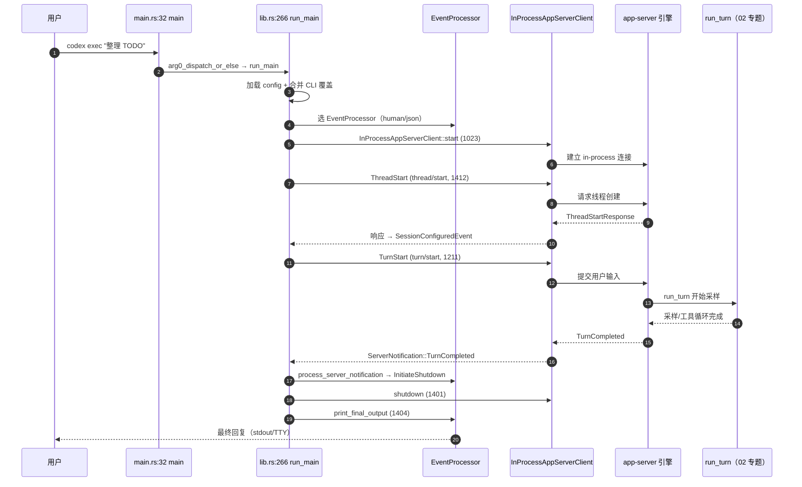

# 05 · 形态A第二层：简单例子 —— `codex exec "prompt"` 全路径走读

> 本篇是形态A「四层阅读法」的第二层：**简单例子**。用一条最简、真实、可运行的成功路径，把 `codex exec` 从进程入口到引擎到输出，完整走一遍。
> 只走主成功路径，分支（resume/fork/review/JSON 模式/沙箱拒绝/中断）在后续层展开。
>
> 文档基线：`main @ 2cab11ca4`（2026-10-27，固定 Rust 1.95.0）。仓库：`codex-rs/`（122 crate，Rust workspace，edition 2024）。
> 锚点记法遵循 [00-docs-style-guide](00-docs-style-guide.md)：`路径 函数：符号 偏移：±N`。

---

## 0. 这条路径在说什么

用户敲下：

```bash
codex exec "把仓库里的 TODO 列表整理成 Markdown"
```

Codex 就完成一件事：**读输入 → 起线程 → 发一轮 turn → 引擎采样/跑工具 → 把最终回复写到终端**。

这是整个 Codex 里**最短的完整链路**：它不像 TUI 那样有交互循环和渲染，却一样穿过 `exec` 客户端 → app-server 进程边界 → 引擎 `run_turn` → 工具执行 → 事件回传 → 输出。走通它，你就拥有了读任何 Codex 代码的「骨架坐标系」。

```
┌─────────────────────────── codex exec 进程 ───────────────────────────┐
│                                                                       │
│  main.rs:32 main                                                      │
│    └─ arg0_dispatch_or_else                                           │
│         └─ lib.rs:266 run_main          ←── 配置/校验/初始化           │
│              ├─ 加载 config.toml + 合并 CLI 覆盖                        │
│              ├─ lib.rs:892 选 event_processor（人读输出/JSON）           │
│              ├─ lib.rs:1023 InProcessAppServerClient::start           │
│              ├─ lib.rs:1155 start_thread → thread/start               │
│              ├─ lib.rs:1211 UserTurn → turn/start                     │
│              ├─ lib.rs:1307 事件循环 select!{interrupt, next_event}    │
│              │     └─ process_server_notification                     │
│              └─ lib.rs:1401 shutdown + print_final_output             │
│                                                                       │
│        ┌──────────────────────── 引擎侧 ───────────────────────┐      │
│        │  run_turn（02 专题核心）                               │      │
│        │    └─ sampling → 工具执行 → needs_follow_up 判定       │      │
│        └───────────────────────────────────────────────────────┘      │
└───────────────────────────────────────────────────────────────────────┘
```

**一句话归纳**：`exec` 是「非交互、单次提问」的薄前端，所有重活在 app-server 内的引擎。

---

## 1. 第一步：进程入口与 arg0 分发

**文件**：`codex-rs/exec/src/main.rs`

```rust
// main.rs:32
fn main() -> anyhow::Result<()> {
    arg0_dispatch_or_else(|arg0_paths: Arg0DispatchPaths| async move {
        let top_cli = TopCli::parse();
        let mut inner = top_cli.inner;
        inner.config_overrides.prepend_root_overrides(top_cli.config_overrides);
        run_main(inner, arg0_paths).await?;
        Ok(())
    })
}
```

- `TopCli` 用 `clap` 解析：`CliConfigOverrides`（根级 `-c key=value`）+ `Cli`（exec 专属参数，见 `cli.rs`）。
- `arg0_dispatch_or_else` 是 `codex-arg0` crate 的分发器：**按 argv[0] 决定跑什么**。正常 `codex exec` 走 `run_main`；但同一个二进制若被以 `codex-linux-sandbox` 的名字调用，就改跑 Landlock+seccomp 沙箱逻辑。这是「一个二进制、多副面孔」的机制。
- 根级 overrides 被 **prepend**（先合并）进 `inner`，保证下游逻辑不变。

**偏移**：`main.rs 函数：main 偏移：+1`（`arg0_dispatch_or_else` 闭包内）。

---

## 2. 第二步：run_main 的初始化三件事

**文件**：`codex-rs/exec/src/lib.rs`

`run_main` 在真正发请求前，先做三件事：

### 2.1 解构 CLI 与合并配置

```rust
// lib.rs:271
let Cli { mut command, strict_config, shared, thread_source, cyber_access_program,
          skip_git_repo_check, ephemeral, ignore_user_config, ignore_rules, color,
          last_message_file, json: json_mode, prompt, output_schema: output_schema_path,
          mut config_overrides } = cli;
```

- `shared`（`SharedCliOptions`）里有 `model`、`sandbox_mode`、`worktree`、`cwd` 等跨子命令公共项。
- `config_overrides` 由 `parse_overrides()` 解析成键值对，之后喂给 `ConfigBuilder`。
- 颜色策略 `color`：`Always/Never/Auto`，`Auto` 时用 `supports_color` 探测 `stdout/stderr` 是否 TTY。这决定后续 human 输出是否带 ANSI。

### 2.2 选 event_processor（决定输出形态）

```rust
// lib.rs:892
let mut event_processor: Box<dyn EventProcessor> = match json_mode {
    true => Box::new(EventProcessorWithJsonOutput::new(last_message_file.clone())),
    _ => Box::new(EventProcessorWithHumanOutput::create_with_ansi(
        stderr_with_ansi, &config, last_message_file.clone(),
    )),
};
```

**关键抽象**：`EventProcessor` trait（`event_processor.rs:13`）定义了 `process_server_notification` / `process_warning` / `print_final_output` / `print_config_summary` 四个方法。`exec` 进程不关心通知怎么变成输出——**它只负责把 app-server 的事件按约定喂给处理器**。

- `--json` → `EventProcessorWithJsonOutput`（每事件一行 JSON，供脚本消费）。
- 默认 → `EventProcessorWithHumanOutput`（人类可读，ANSI + token 统计 + final message）。

### 2.3 起 in-process app-server 客户端

```rust
// lib.rs:1023
let mut client = InProcessAppServerClient::start(in_process_start_args).await
    .map_err(|err| anyhow::anyhow!("failed to initialize in-process app-server client: {err}"))?;
```

`InProcessAppServerClient`（定义于 `codex-rs/app-server-client/src/lib.rs:370` 的 `start`）是**同进程内**的连接：它不是真的子进程，而是把 app-server 的请求处理函数直接挂在内存通道上。这就是「in-process」名字的由来——省去跨进程序列化，但**协议层完全相同**（`ClientRequest`/`ServerNotification` 类型与网络路径共用）。

**为什么不是子进程？** 因为 `codex exec` 是「一次性、低延迟」场景：起真正的 app-server 进程要付进程启动+IPC 建连成本，而 in-process 只在当前进程里多起一个 tokio task。

---

## 3. 第三步：启动线程 thread/start

**文件**：`codex-rs/exec/src/lib.rs`（`start_thread` @1412）

```rust
// lib.rs:1412
async fn start_thread(client, request_ids, config, thread_source)
    -> Result<ThreadStartResponse, String> {
    let mut params = thread_start_params_from_config(config, thread_source);
    loop {
        match client.request_typed(ClientRequest::ThreadStart {
            request_id: request_ids.next(),
            params: params.clone(),
        }).await {
            Ok(response) => return Ok(response),
            Err(TypedRequestError::Server { source, .. })
                if params.history_mode.is_some()
                && source.code == -32600
                && source.message == "paginated threads require thread/turns/list and thread/items/list support" =>
            {
                params.history_mode = None;   // 服务器不支持分页历史 → 降级重试
            }
            Err(err) => return Err(format!("thread/start: {err}")),
        }
    }
}
```

**要点**：
- 发的是 `ClientRequest::ThreadStart`，方法名 `thread/start`，请求体来自 `thread_start_params_from_config`（`lib.rs:1441`）。
- `thread_start_params_from_config` 组装 `ThreadStartParams`：`model`、`model_provider`、`cwd`、`runtime_workspace_roots`、`approval_policy`、`sandbox`、`permissions`、`ephemeral`、`history_mode`、`thread_source`。
  - **sandbox 与 permissions 互斥**：`permissions = permissions_selection_from_config(config)`；若无 permissions 才由 `sandbox_mode_from_permission_profile` 算 sandbox。二者二选一。
  - `history_mode = (!ephemeral).then_some(Paginated)`：非临时线程才要分页历史。
- **降级循环**：若服务器回 `-32600` 且消息表明「不支持分页历史」，把 `history_mode` 置 `None` 重试一次。这是向后兼容老 app-server 的护栏。

**偏移**：`lib.rs 函数：start_thread 偏移：+6`（第一个 `client.request_typed`）。

---

## 4. 第四步：提交用户输入 turn/start

**文件**：`codex-rs/exec/src/lib.rs`（`InitialOperation::UserTurn` @1211）

`thread/start` 建好线程后，`run_main` 用 `session_configured_from_thread_start_response`（`lib.rs:1557`）把响应转成 `SessionConfiguredEvent`（含 `thread_id`、`model`、`approval_policy`、`cwd`、`reasoning_effort` 等），再进入操作分发。

对默认 `codex exec "prompt"`，`initial_operation` 是：

```rust
// lib.rs:1211
InitialOperation::UserTurn { items, output_schema } => {
    let response: TurnStartResponse = send_request_with_response(
        &client,
        ClientRequest::TurnStart {
            request_id: request_ids.next(),
            params: TurnStartParams {
                thread_id: primary_thread_id_for_span.clone(),
                turn_trigger: Some("exec".to_string()),
                input: items.into_iter().map(Into::into).collect(),
                cwd: Some(default_cwd),
                approval_policy: Some(default_approval_policy.into()),
                effort: default_effort,
                output_schema,
                cyber_access_program,       // 见下
                ..Default::default()
            },
        },
        "turn/start",
    ).await.map_err(anyhow::Error::msg)?;
    let task_id = response.turn.id;
    info!("Sent prompt with event ID: {task_id}");
    task_id
}
```

**要点**：
- `turn_trigger: Some("exec")` 标记本 turn 的来源，供审计/统计。
- `input` 是 `Vec<UserInput>`：由 positional prompt（或 stdin）转来。
- `cyber_access_program`：若 CLI 传了 `--cyber-access-program` 直接用；否则若开启 `CliDaybreak` feature，调 `daybreak::program_for_turn` 从 daybreak 状态推导；否则 `None`。
- `send_request_with_response`（`lib.rs:1540`）是薄封装：调 `client.request_typed`，失败时把 `method` 前缀拼进错误（如 `"turn/start: <err>"`）。
- 拿到 `TurnStartResponse`，`task_id = response.turn.id`——**这个 id 是后续所有事件匹配的锚点**。

**偏移**：`lib.rs 函数：send_request_with_response 偏移：+8`（`client.request_typed`）。

---

## 5. 第五步：事件循环 select!

**文件**：`codex-rs/exec/src/lib.rs`（@1307）

```rust
// lib.rs:1307
loop {
    let server_event = tokio::select! {
        maybe_interrupt = interrupt_rx.recv(), if interrupt_channel_open => {
            if maybe_interrupt.is_none() { interrupt_channel_open = false; continue; }
            // Ctrl-C → 发 turn/interrupt
            send_request_with_response::<TurnInterruptResponse>(&client,
                ClientRequest::TurnInterrupt { request_id: request_ids.next(),
                    params: TurnInterruptParams { thread_id: ..., turn_id: task_id.clone() } },
                "turn/interrupt").await;
            continue;
        }
        maybe_event = client.next_event() => maybe_event,
    };
    let Some(server_event) = server_event else { break; };

    match server_event {
        InProcessServerEvent::ServerRequest(request) => {
            handle_server_request(&client, *request, &mut error_seen).await;
        }
        InProcessServerEvent::ServerNotification(notification) => {
            // 错误/失败判定：error_seen
            if should_process_notification(&notification, &primary_thread_id_for_requests, &task_id) {
                maybe_backfill_turn_completed_items(...).await;
                match event_processor.process_server_notification(notification) {
                    CodexStatus::Running => {}
                    CodexStatus::InitiateShutdown => {
                        request_shutdown(...).await;
                        break;
                    }
                }
            }
        }
        InProcessServerEvent::Lagged { skipped } => { /* 事件积压告警 */ }
    }
}
```

**要点**：
- **两个事件源**：`interrupt_rx`（Ctrl-C 信号，`lib.rs:1191` 起了一个 tokio task 监听 `ctrl_c`）和 `client.next_event()`（app-server 推送的事件流）。
- **`should_process_notification` 是过滤器**：只处理与当前线程/turn 相关的通知，避免把其它线程的杂音当成本 turn 的。
- **`CodexStatus` 是控制流信号**（`event_processor.rs:9`）：`Running` = 继续；`InitiateShutdown` = 退循环。**处理器通过返回值驱动主循环**，而不是直接改循环——这是 trait 设计的精髓。
- `Lagged`：事件积压超过缓冲时，`InProcessAppServerClient` 会丢事件并报 `Lagged`，exec 打印告警后继续（不中断 turn）。

**偏移**：`lib.rs 函数：run_main 偏移：+1041`（`tokio::select!` 处，约 1307-1308 行）。

---

## 6. 第六步：TurnCompleted → 收尾

**文件**：`codex-rs/exec/src/event_processor_with_human_output.rs`

当引擎完成，app-server 推 `ServerNotification::TurnCompleted`：

```rust
// event_processor_with_human_output.rs:311
ServerNotification::TurnCompleted(notification) => match notification.turn.status {
    TurnStatus::Completed => {
        // 记录 final_message，供 print_final_output 用
        if let Some(final_message) = final_message_from_turn_items(notification.turn.items.as_slice()) {
            self.final_message_rendered = rendered_message.as_deref() == Some(final_message.as_str());
            self.final_message = Some(final_message);
        }
        self.emit_final_message_on_shutdown = true;
        CodexStatus::InitiateShutdown
    }
    TurnStatus::Failed => { /* 打印 ERROR；emit_final_message_on_shutdown = false */ CodexStatus::InitiateShutdown }
    TurnStatus::Interrupted => { /* 打印 "turn interrupted" */ CodexStatus::InitiateShutdown }
    TurnStatus::InProgress => CodexStatus::Running,
},
```

**要点**：
- `final_message_from_turn_items` 从 turn 的 items 里提取最后一条 assistant 文本消息。
- `Completed` → `emit_final_message_on_shutdown = true`，返回 `InitiateShutdown` → 主循环退。
- 主循环退出后，`run_main` 调 `client.shutdown()`（`lib.rs:1401`）再 `event_processor.print_final_output()`（`lib.rs:1404`）。

**偏移**：`event_processor_with_human_output.rs 函数：process_server_notification 偏移：+82`（`TurnCompleted` 的 `Completed` 分支）。

---

## 7. 第七步：print_final_output —— 把答案交给用户

**文件**：`codex-rs/exec/src/event_processor_with_human_output.rs`（@393）

```rust
// event_processor_with_human_output.rs:393
fn print_final_output(&mut self) {
    if self.emit_final_message_on_shutdown
        && let Some(path) = self.last_message_path.as_deref() {
        handle_last_message(self.final_message.as_deref(), path);   // 写 --last-message-file
    }
    if let Some(usage) = &self.last_total_token_usage {
        eprintln!("{}\n{}", "tokens used".style(self.dimmed), format_with_separators(blended_total(usage)));
    }
    if should_print_final_message_to_stdout(...) && let Some(message) = self.final_message.as_deref() {
        println!("{message}");                       // stdout 非 TTY（管道）→ 纯文本
    } else if should_print_final_message_to_tty(...) && let Some(message) = self.final_message.as_deref() {
        eprintln!("{}\n{}", "codex".style(self.italic).style(self.magenta), message);  // TTY → 带"codex"前缀
    }
}
```

**要点**：
- **三个出口**：`--last-message-file`（机器可读，`handle_last_message` 在 `event_processor.rs:31`）；stdout 纯文本（非 TTY，适合管道）；stderr 带 `codex` 前缀（TTY，人类终端）。
- **token 统计**：`blended_total(usage)` 合并输入/输出/缓存 token，`format_with_separators` 加千分位。
- 这解释了 `codex exec` 在脚本里和终端里输出为何不同——**输出形态由 `is_terminal()` 动态决定**。

**偏移**：`event_processor_with_human_output.rs 函数：print_final_output 偏移：+5`（`handle_last_message` 调用）。

---

## 8. 全路径一图流（Mermaid）



---

## 9. 这一层你该带走的三件事

1. **一条路径串起全部核心概念**：`exec` 进程入口 → config 合并 → `EventProcessor` 抽象 → in-process 客户端 → `thread/start` → `turn/start` → 事件循环 → `TurnCompleted` → 输出。之后读任何模块，先问「它在哪一段」。
2. **`EventProcessor` + `CodexStatus` 是 exec 侧的控制核心**：处理器决定「跑还是停」，exec 主循环只负责转发事件和转发信号。这是「UI 与引擎解耦」的又一例证（同 TUI 的 `App` 状态机）。
3. **in-process ≠ 子进程**：`InProcessAppServerClient` 走内存通道，但协议类型与网络路径完全一致。这解释了为何 `exec` 能这么快、又能复用引擎全部逻辑。

---

## 10. 源码索引（锚点行号，基线 `2cab11ca4`）

| 锚点 | 文件 | 行号 |
|---|---|---|
| `main.rs 函数：main` | `codex-rs/exec/src/main.rs` | 32 |
| `lib.rs 函数：run_main` | `codex-rs/exec/src/lib.rs` | 266 |
| `lib.rs enum：InitialOperation` | `codex-rs/exec/src/lib.rs` | 181 |
| `lib.rs 函数：start_thread` | `codex-rs/exec/src/lib.rs` | 1412 |
| `lib.rs 函数：thread_start_params_from_config` | `codex-rs/exec/src/lib.rs` | 1441 |
| `lib.rs 函数：send_request_with_response` | `codex-rs/exec/src/lib.rs` | 1540 |
| `lib.rs 函数：session_configured_from_thread_start_response` | `codex-rs/exec/src/lib.rs` | 1557 |
| `lib.rs 函数：request_shutdown` | `codex-rs/exec/src/lib.rs` | 2030 |
| `app-server-client/lib.rs 函数：InProcessAppServerClient::start` | `codex-rs/app-server-client/src/lib.rs` | 370 |
| `event_processor.rs trait：EventProcessor` | `codex-rs/exec/src/event_processor.rs` | 13 |
| `event_processor.rs 函数：handle_last_message` | `codex-rs/exec/src/event_processor.rs` | 31 |
| `event_processor_with_human_output.rs 函数：process_server_notification` | `codex-rs/exec/src/event_processor_with_human_output.rs` | 229 |
| `event_processor_with_human_output.rs 函数：print_final_output` | `codex-rs/exec/src/event_processor_with_human_output.rs` | 393 |

---

## 11. 下一步

读 [06-详细逐步](06-详细逐步-exec全链路拆解.md)（形态A第三层）：把这条路径逐跳拆开，看每个请求/响应的**实际字段值**、`run_turn` 采样循环如何在引擎侧推进、以及 `handle_server_request` 如何应答工具回调。
