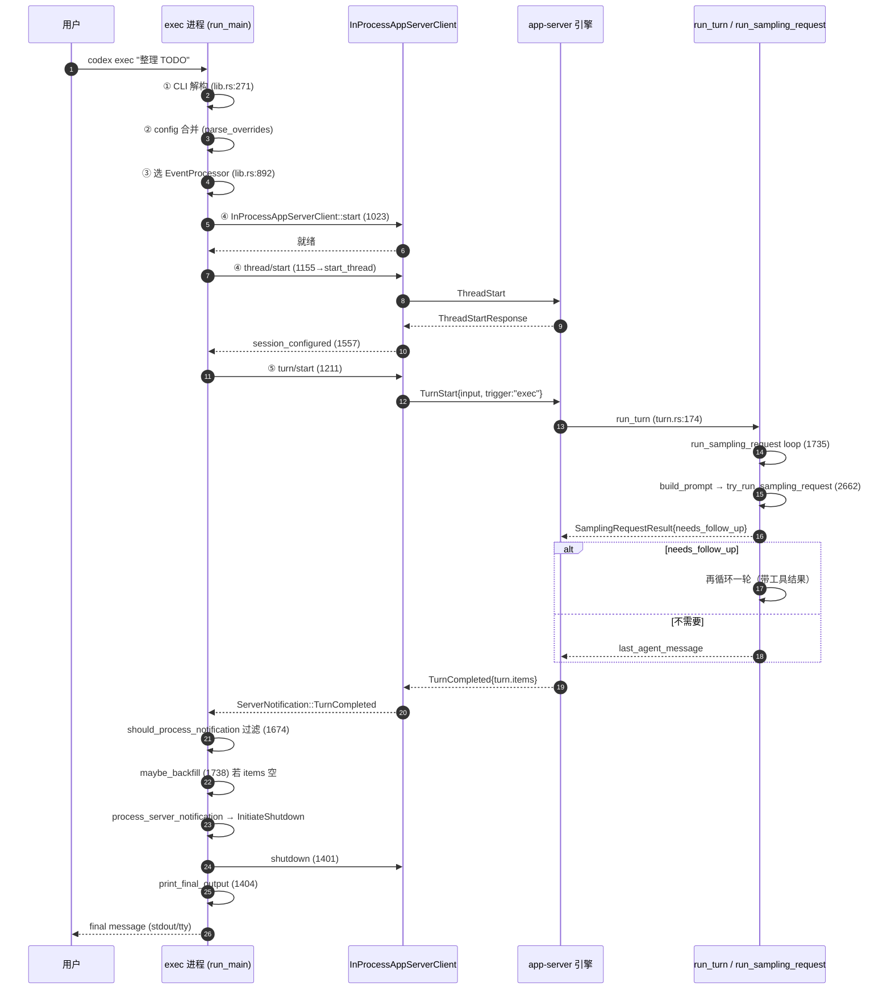

# 06 · 形态A第三层：详细逐步 —— `codex exec` 全链路逐跳拆解

> 本篇是形态A「四层阅读法」的第三层：**详细逐步**。把 05 那条成功路径逐跳拆开，看每一跳的**实际字段值**、请求/响应形状、以及引擎侧采样循环如何推进。
> 重点回答 05 没回答的三个问题：① 请求里到底带哪些字段？② 引擎如何把一轮 turn 跑完（`needs_follow_up` 判定）？③ exec 侧如何处理引擎的服务器回调（approval/elicitation）？
>
> 文档基线：`main @ 2cab11ca4`（2026-10-27，固定 Rust 1.95.0）。仓库：`codex-rs/`（122 crate，Rust workspace，edition 2024）。
> 锚点记法遵循 [00-docs-style-guide](00-docs-style-guide.md)：`路径 函数：符号 偏移：±N`。

---

## 0. 本层拆解地图

```
① exec 进程
    run_main (lib.rs:266)
      ├─ 0. CLI 解构          lib.rs:271
      ├─ 1. config 合并        lib.rs:354  parse_overrides
      ├─ 2. event_processor   lib.rs:892
      ├─ 3. client.start      lib.rs:1023
      ├─ 4. start_thread      lib.rs:1155 → thread/start
      ├─ 5. turn/start        lib.rs:1211 → UserTurn
      ├─ 6. 事件循环          lib.rs:1307 select!
      │     ├─ interrupt      lib.rs:1309 → turn/interrupt
      │     ├─ ServerRequest  lib.rs:1339 → handle_server_request
      │     └─ Notification   lib.rs:1342 → process_server_notification
      └─ 7. shutdown+输出      lib.rs:1401-1404

② 引擎侧（app-server 内）
    turn/start handler
      └─ run_turn (turn.rs:174)
           └─ run_sampling_request (turn.rs:1735)
                └─ loop { build_prompt → try_run_sampling_request → 错误处理 }
                     └─ needs_follow_up 判定（02 专题核心）
```

**本层约定**：凡引擎侧的 `run_turn` 采样循环，只展开「从提交到 `needs_follow_up` 判定」这一段；工具执行的具体实现（`handle_tool_call` 等）在 [02-agent主循环](02-agent主循环.md) 已覆盖，此处只讲衔接。

---

## 1. 跳①：CLI 解构 —— `Cli` 里到底有什么

`run_main` 的第一行就把 `Cli` 拆开（`lib.rs:271`）。`Cli` 是 `clap` 派生的结构体，字段分三组：

| 组 | 字段 | 含义 |
|---|---|---|
| exec 专属 | `command: Option<ExecCommand>` | 子命令：`resume` / `fork` / `review`；`None` = 默认 UserTurn |
| exec 专属 | `prompt` | 位置参数 prompt（或 stdin） |
| exec 专属 | `json` | `--json` 输出模式 |
| exec 专属 | `output_schema` | `--output-schema` 路径 |
| exec 专属 | `last_message_file` | `--last-message-file` |
| exec 专属 | `ephemeral` | 临时线程（不入历史） |
| exec 专属 | `thread_source` | 线程来源（新线程/resume 来源） |
| 公共 | `shared: SharedCliOptions` | `model`、`sandbox_mode`、`worktree`、`cwd`、`images`、`approval_policy`、`dangerously_bypass_approvals_and_sandbox` 等 |
| 公共 | `config_overrides: CliConfigOverrides` | `-c key=value` 覆盖 |

**要点**：`command` 决定 `InitialOperation`。`None` → `UserTurn`（本层主线）；`Some(Resume)` / `Some(Fork)` / `Some(Review)` 走不同分支（`lib.rs:1031` 起）。

---

## 2. 跳②：config 合并 —— 三层配置如何变成 `Config`

`run_main` 用 `ConfigBuilder` 把「用户配置 + 项目配置 + CLI 覆盖」合成最终的 `Config`（`lib.rs:417` 附近，worktree 分支内是 gate_config；主线在别处构建，此处以主线为准）：

```
config.toml（用户，~/.codex/）
    + 项目 config.toml（cwd 下，若有）
    + -c key=value（CLI 覆盖，parse_overrides 于 lib.rs:354）
    ───────────────────────────────
    → ConfigBuilder::build()  →  Config
```

**关键字段**（供下游 `thread_start_params_from_config` 使用）：
- `config.model` / `config.model_provider_id`：模型与 provider。
- `config.permissions.effective_permission_profile()`：权限 profile（决定 sandbox 或 permissions）。
- `config.cwd` / `config.workspace_roots`：工作目录与运行时 workspace 根。
- `config.ephemeral`：是否临时线程。
- `config.daybreak_enabled`：daybreak 特性开关。

**护栏**：`-c` 解析失败直接 `eprintln!` + `exit(1)`（`lib.rs:356-359`），不让坏覆盖流进引擎。

---

## 3. 跳③：event_processor —— 两种输出形态的取舍

见 05 第 2.2 节，`lib.rs:892`。补充一点：**`EventProcessorWithHumanOutput::create_with_ansi`** 内部还持有 `last_message_path`（`--last-message-file`）和 ANSI 开关，并把「是否最终输出」的记录放在 `self.emit_final_message_on_shutdown` 上——这是 `print_final_output` 的闸门。

---

## 4. 跳④：`thread/start` 的字段真相

`thread_start_params_from_config`（`lib.rs:1441`）组装的 `ThreadStartParams` 实际字段（主线，非 resume/fork）：

```rust
ThreadStartParams {
    model: config.model.clone(),
    model_provider: Some(config.model_provider_id.clone()),
    cwd: Some(config.cwd.to_string_lossy().to_string()),
    runtime_workspace_roots: Some(config.workspace_roots.clone()),
    approval_policy: Some(config.permissions.approval_policy.value().into()),
    approvals_reviewer: Some(config.approvals_reviewer.into()),
    sandbox: sandbox.flatten(),          // 仅当 permissions.is_none() 时 Some
    permissions,                          // permissions_selection_from_config(config)
    config: thread_config_overrides_from_config(config),
    ephemeral: Some(config.ephemeral),
    daybreak_enabled: (config.daybreak_enabled && !config.ephemeral).then_some(true),
    history_mode: (!config.ephemeral).then_some(ThreadHistoryMode::Paginated),
    thread_source: Some(thread_source.clone()),
    ..ThreadStartParams::default()
}
```

**三个「互斥/条件」规则**：
1. **sandbox ⟂ permissions**：`permissions = permissions_selection_from_config(config)`；只有 `permissions.is_none()` 时才 `sandbox_mode_from_permission_profile(...)`。二者不能同给。
2. **daybreak 只在非临时线程**：`config.daybreak_enabled && !config.ephemeral`。
3. **history_mode 只在非临时线程**：临时线程不要分页历史。

`thread/start` 的响应是 `ThreadStartResponse`，`session_configured_from_thread_start_response`（`lib.rs:1557`）把它压成 `SessionConfiguredEvent`——**这是 exec 进程内「线程已建好」的权威信号**，之后才能发 turn。

---

## 5. 跳⑤：`turn/start` 的字段真相（用户输入提交）

`InitialOperation::UserTurn`（`lib.rs:1211`）组装 `TurnStartParams`：

```rust
TurnStartParams {
    thread_id: primary_thread_id_for_span.clone(),   // 来自跳④的 thread_id
    turn_trigger: Some("exec".to_string()),          // 审计/统计标记
    input: items.into_iter().map(Into::into).collect(),  // Vec<UserInput>
    cwd: Some(default_cwd),
    approval_policy: Some(default_approval_policy.into()),
    effort: default_effort,
    output_schema,                                    // --output-schema 解析结果
    cyber_access_program,                             // daybreak 或 CLI 或 None
    ..Default::default()                              // 其余全默认
}
```

**响应**：`TurnStartResponse { turn: { id, ... }, ... }`，取 `task_id = response.turn.id`。这个 id 贯穿整个事件循环——`should_process_notification` 用它过滤无关事件。

---

## 6. 跳⑥：事件循环 —— 三个分支的职责

`lib.rs:1307` 的 `tokio::select!` 三路并发：

### 6.1 中断分支（interrupt_rx）

`lib.rs:1191` 起的 tokio task 监听 `ctrl_c()`，收到就 `interrupt_tx.send(())`。事件循环收到后发 `turn/interrupt`（`TurnInterruptParams { thread_id, turn_id }`）。**exec 的中断是「优雅打断」**：不是杀进程，而是请求引擎停止当前采样。

### 6.2 ServerRequest 分支 —— 引擎在向 exec 要东西

引擎在 turn 过程中可能发回**服务器请求**（不是通知，是要 exec 答复）。`handle_server_request`（`lib.rs:2089`）逐类处理：

| ServerRequest 变体 | exec 的处理 | 理由 |
|---|---|---|
| `McpServerElicitationRequest` | **自动取消**（resolve 一个 cancel 值） | exec 非交互，无法弹 elicitation UI |
| `CommandExecutionRequestApproval` | **拒绝**（-32000） | exec 不支持命令审批 |
| `FileChangeRequestApproval` | **拒绝** | 同上 |
| `ToolRequestUserInput` | **拒绝** | 同上 |
| `DynamicToolCall` | **拒绝** | 同上 |
| `ChatgptAuthTokensRefresh` | **拒绝** | 同上 |
| `AttestationGenerate` | **拒绝** | 同上 |
| `CurrentTimeRead` | **拒绝** | 同上 |
| `ApplyPatchApproval` | **拒绝** | 同上 |
| `ExecCommandApproval` | **拒绝** | 同上 |
| `PermissionsRequestApproval` | **拒绝** | 同上 |

**要点**：`exec` 是**非交互**前端，凡是要「人做决定」的请求一律拒绝（`reject_server_request`，`lib.rs:2058`）或自动取消（elicitation，`lib.rs:2100`）。唯一的例外是 `McpServerElicitationRequest`——它被自动 cancel 而不是拒绝，为的是「不把 cancel 变成 decline/error」。
- `resolve_server_request`（`lib.rs:2046`）和 `reject_server_request`（`lib.rs:2058`）是薄封装，错误码统一 `-32000`。
- `error_seen` 标记：任一 reject/resolve 失败，`*error_seen = true`（`lib.rs:2226`），最终导致 `exit(1)`。

### 6.3 Notification 分支 —— 引擎的进度通知

`should_process_notification`（`lib.rs:1674`）是**过滤器**：按变体决定是否放行。全局放行：`ConfigWarning` / `DeprecationNotice`；按 thread_id（+turn_id）匹配：`Error`、`ItemCompleted`、`TurnCompleted`、`TurnStarted` 等。**不匹配的丢弃**，避免把别的线程/turn 事件混进本 turn。

**量化边界**（实测 `common.rs:1973` 的宏定义）：`ServerNotification` 枚举共 **76 个变体**，`should_process_notification` 只**显式匹配 17 个**，其余 **59 个**走 `_ => false` 被直接丢弃。被丢弃的代表变体：

| 类别 | 被丢弃的变体（示例） | 为什么丢弃是合理的 |
|---|---|---|
| 账户/网络 | `AccountUpdated`、`AccountRateLimitsUpdated`、`GatewayOAuthChanged` | 与单次 turn 无关，exec 非交互无账户 UI |
| 文件系统 | `FsChanged`、`ProjectChanged` | 后台文件变更，exec 单次执行不关心 |
| MCP | `McpToolCallProgress`、`McpServerStatusUpdated`、`McpServerOauthLoginCompleted` | 工具进度，exec 只等最终 turn 结果 |
| 进程 | `ProcessExited`、`ProcessOutputDelta`、`CommandExecOutputDelta` | 命令输出流，exec 非交互无需实时回显 |
| 线程元数据 | `ThreadArchived`、`ThreadDeleted`、`ThreadQueueChanged`、`ThreadClosed`、`SkillsChanged` | 跨线程管理事件，与本 turn 无关 |
| 流式增量 | `AgentMessageDelta`、`PlanDelta`、`RawResponseCompleted`、`ReasoningSummaryTextDelta` | exec 不渲染增量，只在 `TurnCompleted` 拿最终 items |

> **关键洞察**：exec 是「要最终答案」的一次性前端，**不消费增量流**（`*Delta` 全部丢弃），也不消费与本 turn 无关的元数据事件。真正关心的只有 17 个与当前 `thread_id + turn_id` 直接相关的进度/错误/完成事件。若未来想让 `codex exec` 显示实时流，需在这 17 个之外显式放行 `*Delta` 变体——这是扩展点，不是缺陷。

放行后先 `maybe_backfill_turn_completed_items`（`lib.rs:1738`）：若 `TurnCompleted` 的 `items` 为空（in-process 背压下可能丢非终态 item 通知），则补发一次 `thread/read` 拉回完整 items，供 human/json 输出恢复 final message。这是 `turn/completed` 保证「一定有 items」的补丁。

然后 `event_processor.process_server_notification(notification)`，看返回的 `CodexStatus`：`Running` 继续，`InitiateShutdown` 则 `request_shutdown`（`lib.rs:2030`，发 `thread/unsubscribe`）并 break。

---

## 7. 跳⑦：引擎侧 run_turn 采样循环

`turn/start` 的请求进入 app-server 后，引擎在 `run_turn`（`turn.rs:174`）里推进。关键链路：

```
run_turn (turn.rs:174)
  ├─ run_pre_sampling_compact (turn.rs:201)  ← 预压缩（context 超阈值时）
  ├─ run_hooks_and_record_inputs (turn.rs:211) ← 记录用户输入 + 跑 prompt hooks
  ├─ 采样循环主体（在 run_turn 内建 StepContext 后进入 run_sampling_request）
  └─ 结果 → 决定是否 needs_follow_up
```

### 7.1 `run_sampling_request`（turn.rs:1735）的结构

```rust
async fn run_sampling_request(sess, step_context, turn_store, turn_diff_tracker,
                              client_session, input, cancellation_token) {
    let tool_runtime = ToolCallRuntime::new(sess, step_context, turn_diff_tracker);
    let max_retries = turn_context.provider.info().stream_max_retries();
    let mut retry_state = ResponsesStreamRetryState::default();
    let mut initial_input = Some(input);
    let mut original_input = None;
    loop {
        let prompt_input = initial_input.take().unwrap_or(sess.clone_history().await.for_prompt(...));
        // ① 组装 prompt
        let mut prompt = build_prompt(prompt_input, step_context.as_ref(), base_instructions, incremental_tools);
        // ② 发采样请求
        match try_run_sampling_request(tool_runtime.clone(), sess, step_context, turn_store,
                                       client_session, &responses_metadata, turn_diff_tracker,
                                       &prompt, cancellation_token.child_token(), &mut draining_for_mailbox).await {
            Ok(output) => return Ok((output, original_input.unwrap_or(prompt.input))),
            Err(err) => match err.details() {
                CodexErrorDetails::ContextWindowExceeded => { /* 标记 context 满，返回 err */ }
                CodexErrorDetails::UsageLimitReached(e) => { /* 更新 rate_limits，返回 err */ }
                _ => err,
            },
        }
        // ③ 错误重试
        let retry = handle_response_stream_error(&mut retry_state, max_retries, err, ...).await?;
        if preempt.is_cancelled() || (draining_for_mailbox && retry==Ok(Ok(()))) {
            return Ok((SamplingRequestResult { needs_follow_up: true, last_agent_message: None }, original_input));
        }
        retry??;
        turn_context.turn_timing_state.record_sampling_retry();
    }
}
```

**要点**：
- **`loop` 是重试循环**：`try_run_sampling_request` 失败（流错误/限流）→ `handle_response_stream_error` 决定是否重试。`max_retries` 来自 provider 的 `stream_max_retries()`。
- **`initial_input.take()`**：第一轮用传入的 input；之后从 `sess.clone_history()` 取历史（因为上下文已更新）。
- **错误分类**：`ContextWindowExceeded` / `UsageLimitReached` 是**不重试**的终态错误，直接返回 err。
- **`needs_follow_up` 出现在返回类型 `SamplingRequestResult`**：它决定 run_turn 外层是否再循环一轮（见 7.3）。

### 7.2 `try_run_sampling_request`（turn.rs:2662）

这是真正的「发请求 → 流式接收 → 工具执行」主体。它内部：
- 发 `ResponsesStreamRequest::Sampling`（构建 prompt 后）。
- 流式接收 `ResponseItem`，逐项 `handle_output_item_done`（`core/src/stream_events_utils.rs:317`）落库/发射。
- 遇到工具调用 → `handle_tool_call`（工具并行执行，见 02 专题）。
- 流结束 → 返回 `SamplingRequestResult { needs_follow_up, last_agent_message }`。

**`needs_follow_up` 的判定不变量**（02 专题核心）：
- 有工具调用 → 需要 follow-up（继续采样，让模型看到工具结果）。
- 用户插话（`input_queue` 有新的 user input）→ 需要 follow-up。
- 纯 assistant 消息、无工具 → **不需要** follow-up（turn 结束）。

### 7.3 结果回传

`run_turn` 拿到 `SamplingRequestResult` 后，若 `needs_follow_up` 则**再进一轮**（重建 prompt 输入为「历史+工具结果」）；否则结束，返回 `last_agent_message`。这个最后的消息被引擎包装成 `TurnCompleted` 通知（带 `turn.items`）推回 exec。

---

## 8. 跳⑧：TurnCompleted → final message → 输出

见 05 第 6、7 节。补充两个关键细节：

### 8.1 `final_message_from_turn_items` 的取法

```rust
// event_processor_with_human_output.rs:502
fn final_message_from_turn_items(items) -> Option<String> {
    items.iter().rev()
        .find_map(|item| match item.borrow() {
            ThreadItemPayload::AgentMessage { text, .. } => Some(text.clone()),
            _ => None,
        })
        .or_else(|| items.iter().rev().find_map(|item| match item.borrow() {
            ThreadItemPayload::Plan { text, .. } => Some(text.clone()),
            _ => None,
        }))
}
```

**倒序找最后一条 `AgentMessage`**，找不到再找最后一条 `Plan`。这就是「final message = 最后一条 assistant 文本（或计划）」的规则。

### 8.2 输出的两难判断

```rust
// event_processor_with_human_output.rs:526
fn should_print_final_message_to_stdout(final_message, stdout_is_terminal, stderr_is_terminal) -> bool {
    final_message.is_some() && !(stdout_is_terminal && stderr_is_terminal)
}
fn should_print_final_message_to_tty(final_message, final_message_rendered, stdout_is_terminal, stderr_is_terminal) -> bool {
    final_message.is_some() && !final_message_rendered && stdout_is_terminal && stderr_is_terminal
}
```

- **stdout 路径**：stdout/stderr **不全**是 TTY（如管道、重定向）→ 纯文本打到 stdout。这是脚本场景。
- **tty 路径**：stdout 和 stderr **都**是 TTY 且消息未渲染过 → 带 `codex` 前缀打到 stderr。这是人类终端场景。
- 二者互斥（`!(both tty)` vs `both tty`）。

---

## 9. 全链路时序图（含引擎侧采样循环）



---

## 10. 本层新增的源码锚点

| 锚点 | 文件 | 行号 |
|---|---|---|
| `lib.rs 函数：should_process_notification` | `codex-rs/exec/src/lib.rs` | 1674 |
| `common.rs 宏调用：server_notification_definitions` | `codex-rs/app-server-protocol/src/protocol/common.rs` | 1973 |
| `lib.rs 函数：maybe_backfill_turn_completed_items` | `codex-rs/exec/src/lib.rs` | 1738 |
| `lib.rs 函数：should_backfill_turn_completed_items` | `codex-rs/exec/src/lib.rs` | 1783 |
| `lib.rs 函数：handle_server_request` | `codex-rs/exec/src/lib.rs` | 2089 |
| `lib.rs 函数：resolve_server_request` | `codex-rs/exec/src/lib.rs` | 2046 |
| `lib.rs 函数：reject_server_request` | `codex-rs/exec/src/lib.rs` | 2058 |
| `lib.rs 函数：server_request_method_name` | `codex-rs/exec/src/lib.rs` | 2077 |
| `turn.rs 函数：run_turn` | `codex-rs/core/src/session/turn.rs` | 174 |
| `turn.rs 函数：run_sampling_request` | `codex-rs/core/src/session/turn.rs` | 1735 |
| `turn.rs 函数：try_run_sampling_request` | `codex-rs/core/src/session/turn.rs` | 2662 |
| `event_processor_with_human_output.rs 函数：final_message_from_turn_items` | `codex-rs/exec/src/event_processor_with_human_output.rs` | 502 |
| `event_processor_with_human_output.rs 函数：should_print_final_message_to_stdout` | `codex-rs/exec/src/event_processor_with_human_output.rs` | 526 |
| `event_processor_with_human_output.rs 函数：should_print_final_message_to_tty` | `codex-rs/exec/src/event_processor_with_human_output.rs` | 534 |

---

## 11. 下一步

读第四层（[07-源码补齐](07-源码补齐-核心模块与数据流.md)）：把 exec 与引擎的**类/结构体关系**、**配置与数据流**、**启动生命周期与状态机**系统化补齐，回答「这个项目为什么长这样」。
