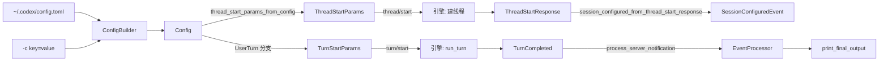

# 07 · 形态A第四层：源码补齐 —— 核心模块、类型关系与生命周期

> 本篇是形态A「四层阅读法」的第四层：**源码补齐**。不再走某一条路径，而是把整个系统的**骨架关系**补齐——核心类型/模块怎么组织、配置与数据流怎么走、启动生命周期与状态机长什么样。
> 回答第四层的标准问题：① 这个项目为什么长这样？② 核心类型之间谁拥有谁？③ 一次 turn 的生命周期状态机。
>
> 文档基线：`main @ 2cab11ca4`（2026-10-27，固定 Rust 1.95.0）。仓库：`codex-rs/`（122 crate，Rust workspace，edition 2024）。
> 锚点记法遵循 [00-docs-style-guide](00-docs-style-guide.md)：`路径 函数：符号 偏移：±N`。

---

## 0. 本层地图

```
形态A第四层 = 四个「补齐」维度
  ① 核心类型关系：Session / TurnContext / StepContext / Config / EventProcessor 谁拥有谁
  ② 协议接口设计：ClientRequest / ServerNotification / ServerRequest / CodexStatus
  ③ 配置与数据流：Config 如何合成、如何流入 ThreadStartParams/TurnStartParams
  ④ 生命周期与状态机：线程→turn→采样循环→输出 的状态推进
```

---

## 1. 核心类型关系（谁拥有谁）

### 1.1 exec 进程侧

```
Cli (clap 派生)
  └─ ExecCommand (resume/fork/review/None=UserTurn)
  └─ SharedCliOptions (model/sandbox_mode/worktree/cwd/...)
  └─ CliConfigOverrides (-c key=value)

InitialOperation (enum, lib.rs:181)
  ├─ ForkOnly
  ├─ UserTurn { items: Vec<UserInput>, output_schema: Option<Value> }
  └─ Review { review_request }

Box<dyn EventProcessor> (trait, event_processor.rs:13)
  ├─ EventProcessorWithHumanOutput (人类可读)
  └─ EventProcessorWithJsonOutput (每事件一行 JSON)

InProcessAppServerClient (app-server-client/src/lib.rs:370)
  ├─ start(args) -> Self
  ├─ request_typed(ClientRequest) -> TypedRequest  // 发请求
  ├─ next_event() -> Option<InProcessServerEvent>  // 收事件
  └─ resolve/reject_server_request(...)             // 答复引擎请求
```

**关键不变量**：
- `InitialOperation` 与 `command: Option<ExecCommand>` 对应——`None` 命令即 `UserTurn`。
- `EventProcessor` 是 `Box<dyn Trait>`（动态分发），因为 json/human 二选一在运行时决定。
- `InProcessAppServerClient` 是 exec 与引擎之间**唯一的通信口**——请求/响应/事件/服务器回调全部走它。

### 1.2 引擎侧（app-server 内）

```
Session (session.rs:60)          ← 一个线程一个 Session
  ├─ thread_id / installation_id
  ├─ state: Mutex<SessionState>          ← 会话可变状态（锁保护）
  ├─ active_turn: Mutex<Option<ActiveTurn>> ← 当前活动 turn
  ├─ input_queue: InputQueue             ← 用户插话队列
  ├─ tx_event: Sender<Event>             ← 向外发事件
  └─ services: SessionServices           ← 依赖注入的公共服务

TurnContext (turn_context.rs:323) ← 一次 turn 的上下文
  ├─ sub_id / config: Arc<Config>
  ├─ provider: SharedModelProvider
  ├─ cwd / history_mode / session_source
  └─ initial_settings: Arc<ResolvedStepSettings>

StepContext (step_context.rs:23)   ← 一次采样请求的上下文
  ├─ turn: Arc<TurnContext>        ← 指向所属 turn
  ├─ settings: Arc<ResolvedStepSettings>
  ├─ tool_router: Arc<ToolRouter>  ← 本步的工具计划
  ├─ mcp: Arc<McpBinding>          ← 本步的 MCP 绑定
  └─ extension_data / environments
```

**三个层次的嵌套**：
```
Session (线程级, 长生命周期)
  └─ TurnContext (turn级, 一次用户提问)
       └─ StepContext (采样级, 一次 sampling request)
```

**为什么三层？**
- `Session` 持有跨 turn 的稳定状态（thread_id、services、input_queue）。
- `TurnContext` 冻结一次 turn 的配置（config、provider、cwd）——**turn 内 config 不变**。
- `StepContext` 冻结一次采样请求的工具/环境/MCP 快照——**每次重试或 follow-up 都可能不同**（因为工具声明可能变）。

这个分层是 Codex 的「不可变快照」哲学：**可变的东西锁进 `Mutex`，不变的东西冻结进 `Arc`**。

---

## 2. 协议接口设计（exec ↔ 引擎的契约）

### 2.1 三方向消息

| 方向 | 类型 | 载体 | 说明 |
|---|---|---|---|
| exec → 引擎 | `ClientRequest` | `request_typed` | 发指令：`ThreadStart`/`TurnStart`/`TurnInterrupt`/`ThreadRead`/`ThreadUnsubscribe` |
| 引擎 → exec | `ServerNotification` | `next_event` | 进度事件：`TurnStarted`/`ItemStarted`/`TurnCompleted`/`Error`/`TurnDiffUpdated` |
| 引擎 → exec（需答复） | `ServerRequest` | `next_event` | **回调**：approval/elicitation 等，exec 必须 `resolve`/`reject` |

### 2.2 关键协议结构体

**`ThreadStartParams`**（app-server-protocol/src/protocol/v2/thread.rs:62）：
```
model / model_provider / cwd / runtime_workspace_roots
approval_policy / approvals_reviewer
sandbox / permissions        ← 二选一
config / ephemeral / daybreak_enabled / history_mode / thread_source
```

**`TurnStartParams`**（protocol/v2/turn.rs:173）：
```
thread_id / turn_trigger / input: Vec<UserInput>
parent_turn_id / root_turn_id          ← 委托工作链（多代理）
approval_policy / effort / output_schema
cyber_access_program                    ← daybreak
```

**`ServerNotification`**（app-server-protocol，`TurnCompleted`/`TurnStarted`/`ItemStarted`/...）：
每个变体都带 `thread_id` + `turn_id`（或 `turn.id`），这是 `should_process_notification` 过滤的键。

**`CodexStatus`**（event_processor.rs:9）：
```rust
pub enum CodexStatus { Running, InitiateShutdown }
```
**这是 exec 侧控制流的「返回值协议」**——不是异常，不是回调，是 `process_server_notification` 的返回值。

### 2.3 设计要点

- **`ServerRequest` 与 `ServerNotification` 分开**：前者要答复（request/response），后者是单向 fire-and-forget。这是 JSON-RPC 的标准划分。
- **exec 对所有 `ServerRequest` 一律 reject（或自动 cancel elicitation）**：因为 exec 非交互，没有任何人能点「允许/拒绝」。这是「前端能力边界」的体现——**TUI 能答，exec 不能**。
- **错误码统一 `-32000`**（`reject_server_request`，lib.rs:2067）：自定义 JSON-RPC 错误码，不撞标准码。

---

## 3. 配置与数据流

### 3.1 配置合成（Config 从哪来）

```
~/.codex/config.toml (用户)                ┐
项目 .codex/config.toml (cwd, 可选)        ├→ ConfigLayerStack → ConfigBuilder::build → Config
-c key=value (CLI 覆盖, parse_overrides)   ┘
```

`Config`（config/mod.rs:627）核心字段：
- `model` / `model_provider_id` / `model_provider`：模型与 provider。
- `permissions` / `custom_permission_profiles` / `approvals_reviewer`：权限体系。
- `model_auto_compact_token_limit` / `model_post_turn_compact_threshold_percent`：上下文压缩。
- `daybreak_enabled` / `service_tier`：特性开关。
- `startup_warnings`：加载时收集的警告（startup 显示）。

### 3.2 配置 → 协议参数的映射（两条路径）

**路径A：`thread/start`**
```
Config
  ├─ .model → ThreadStartParams.model
  ├─ .model_provider_id → ThreadStartParams.model_provider
  ├─ .cwd → ThreadStartParams.cwd
  ├─ .workspace_roots → ThreadStartParams.runtime_workspace_roots
  ├─ .permissions.approval_policy → ThreadStartParams.approval_policy
  ├─ .permissions.effective_permission_profile() → sandbox 或 permissions
  └─ .ephemeral → ephemeral / history_mode / daybreak_enabled
```
映射函数：`thread_start_params_from_config`（lib.rs:1441）。

**路径B：`turn/start`**
```
TurnStartParams
  ├─ thread_id          ← 来自 thread/start 响应
  ├─ input              ← 用户 prompt（items）
  ├─ approval_policy    ← 线程默认
  ├─ effort             ← 用户/配置
  ├─ output_schema      ← --output-schema
  └─ cyber_access_program ← daybreak 或 CLI
```
映射函数：`InitialOperation::UserTurn` 分支（lib.rs:1211）。

### 3.3 数据流一图流



---

## 4. 生命周期与状态机

### 4.1 exec 进程生命周期（run_main 状态推进）

```
[解析 CLI] → [合成 Config] → [建 EventProcessor] → [起 InProcess client]
   → [thread/start] → [turn/start] → [事件循环]
        ├─ ServerRequest → reject/resolve
        └─ Notification → process (Running / InitiateShutdown)
   → [shutdown] → [print_final_output] → [exit(0/1)]
```

状态由 `CodexStatus` 驱动：`Running` 保持循环，`InitiateShutdown` 退出。**没有独立的显式状态机枚举**——循环 + 返回值就是状态机。

### 4.2 turn 生命周期（run_turn 内部）

```
TurnStart
  → run_pre_sampling_compact (上下文超阈值则压缩)
  → run_hooks_and_record_inputs (记录用户输入 + prompt hooks)
  → run_sampling_request (采样循环)
       └─ loop {
            build_prompt → try_run_sampling_request
            ├─ Ok → 返回 SamplingRequestResult
            └─ Err → handle_response_stream_error → 重试 or 返回
          }
  → 若 needs_follow_up → 再进采样循环
  → 否则 → 返回 last_agent_message → TurnCompleted
```

**三个状态出口**（`SamplingRequestResult`）：
- `needs_follow_up = true`：有工具调用/用户插话 → 继续循环。
- `needs_follow_up = false`：纯 assistant 消息 → turn 结束。
- `ContextWindowExceeded` / `UsageLimitReached`：终态错误，不重试。

### 4.3 并发模型

| 元素 | 同步原语 | 用途 |
|---|---|---|
| `Session.state` | `Mutex<SessionState>` | 线程内可变状态 |
| `Session.active_turn` | `Mutex<Option<ActiveTurn>>` | 当前活动 turn |
| `TurnContext` | `Arc<TurnContext>` | 不可变快照，多任务共享 |
| `StepContext` | `Arc<StepContext>` | 不可变快照 |
| `input_queue` | `InputQueue` (async channel) | 用户插话 |
| 事件发送 | `Sender<Event>` | 向 app-server 发事件 |
| 中断 | `CancellationToken` | 采样/重试的取消 |

**核心哲学**：
- **共享可变状态** → `Mutex` + 细粒度锁。
- **跨任务共享不可变数据** → `Arc`。
- **取消** → `CancellationToken`（tokio-util），贯穿采样与重试。
- **背压** → `InProcessAppServerClient` 内部有缓冲，溢出丢事件报 `Lagged`。

---

## 5. 第四层总结：这个项目为什么长这样

1. **多进程 + 协议解耦**：exec/TUI 是薄前端，app-server 是引擎守护进程。二者靠 `ClientRequest`/`ServerNotification`/`ServerRequest` 三种消息契约通信，**前端可换（exec/TUI/CLI）而引擎不动**。
2. **in-process 是性能捷径**：`InProcessAppServerClient` 复用同一协议类型但走内存通道，`exec` 这种一次性场景免去进程启动成本。
3. **三层快照隔离**：`Session`(线程) → `TurnContext`(turn) → `StepContext`(采样)。**越往里越不可变**，避免采样重试时配置漂移。
4. **非交互前端 = 全拒绝**：exec 对一切需要人类决策的 `ServerRequest` 一律 reject。能力边界由「前端能否应答」决定，而不是引擎。
5. **返回值协议驱动控制流**：`EventProcessor::process_server_notification → CodexStatus`，处理器决定跑/停，主循环只转发。UI 与引擎解耦的又一体现。

---

## 6. 本层新增源码锚点

| 锚点 | 文件 | 行号 |
|---|---|---|
| `config/mod.rs struct：Config` | `codex-rs/core/src/config/mod.rs` | 627 |
| `config/mod.rs struct：ConfigBuilder` | `codex-rs/core/src/config/mod.rs` | 1493 |
| `session.rs struct：Session` | `codex-rs/core/src/session/session.rs` | 60 |
| `session.rs struct：SessionConfiguration` | `codex-rs/core/src/session/session.rs` | 107 |
| `step_context.rs struct：StepContext` | `codex-rs/core/src/session/step_context.rs` | 23 |
| `turn_context.rs struct：TurnContext` | `codex-rs/core/src/session/turn_context.rs` | 323 |
| `protocol/v2/thread.rs struct：ThreadStartParams` | `codex-rs/app-server-protocol/src/protocol/v2/thread.rs` | 62 |
| `protocol/v2/turn.rs struct：TurnStartParams` | `codex-rs/app-server-protocol/src/protocol/v2/turn.rs` | 173 |
| `protocol/v2/turn.rs struct：TurnStartResponse` | `codex-rs/app-server-protocol/src/protocol/v2/turn.rs` | 311 |
| `turn.rs 函数：try_run_sampling_request` | `codex-rs/core/src/session/turn.rs` | 2662 |

---

## 7. 形态A 四层回顾与后续

至此形态A（四层阅读法）完成：

| 层 | 文档 | 内容 |
|---|---|---|
| 第一层 简单框架 | [01-系统骨架](01-系统骨架.md) | 18 可执行 crate、进程/模块/职责全景 |
| 第二层 简单例子 | [05-简单例子-全路径走读](05-简单例子-全路径走读.md) | `codex exec` 最短完整成功路径 |
| 第三层 详细逐步 | [06-详细逐步-exec全链路拆解](06-详细逐步-exec全链路拆解.md) | 逐跳字段、采样循环、needs_follow_up |
| 第四层 源码补齐 | 本篇 | 核心类型关系、协议契约、配置流、生命周期 |

**三个形态B专题**（纵深）：
- [02-agent主循环](02-agent主循环.md)：`run_turn` 采样循环与工具并行。
- [03-tui交互层](03-tui交互层.md)：TUI 事件循环与安全块改写。
- [04-sandboxing沙箱](04-sandboxing沙箱.md)：跨平台沙箱后端与策略。

**下一步建议**：任选一个形态B专题深入，或回到 01 系统骨架，按 Mermaid 学习路径挑一条线继续读。
