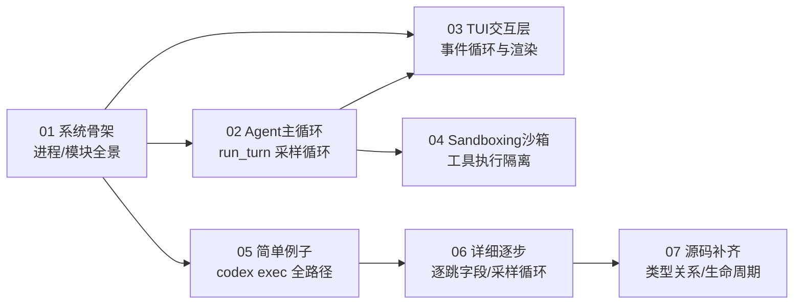

# Codex 源码阅读文档

> 本目录是 OpenAI Codex CLI 的源码阅读文档，从「系统骨架」到「核心机制专题」分层组织。
> 文档基线：`main @ 2cab11ca4`（2026-10-27，固定 Rust 1.95.0）。仓库：`codex-rs/`（122 crate，Rust workspace，edition 2024）。

## 文档导航

| 文档 | 层级 | 一句话定位 |
|---|---|---|
| [00-docs-style-guide](00-docs-style-guide.md) | 规范 | 源码锚定文档的统一规范：事实红线、锚点记法、状态分级 |
| [01-系统骨架](01-系统骨架.md) | 形态A·第一层 | 进程/模块/职责/主数据流：生产 18 + 开发 3 = 21 个可执行、命令面、core 引擎、app-server 通信 |
| [02-agent主循环](02-agent主循环.md) | 形态B·专题 | `run_turn` 从输入到回复：sampling 循环、工具并行执行、needs_follow_up 不变量 |
| [03-tui交互层](03-tui交互层.md) | 形态B·专题 | TUI 事件循环：6 分支 select!、committed/active cell 渲染、安全块改写机制 |
| [04-sandboxing沙箱](04-sandboxing沙箱.md) | 形态B·专题 | 跨平台沙箱：Seatbelt/bubblewrap+seccomp/RestrictedToken/MXC、策略变换 |
| [05-简单例子-全路径走读](05-简单例子-全路径走读.md) | 形态A·第二层 | `codex exec` 最短完整成功路径：入口→thread/start→turn/start→事件循环→输出 |
| [06-详细逐步-exec全链路拆解](06-详细逐步-exec全链路拆解.md) | 形态A·第三层 | 逐跳字段真相、引擎采样循环、needs_follow_up 判定、ServerRequest 全拒绝 |
| [07-源码补齐-核心模块与数据流](07-源码补齐-核心模块与数据流.md) | 形态A·第四层 | 核心类型关系（Session/TurnContext/StepContext）、协议契约、配置流、生命周期 |

## Mermaid 学习路径

**建议阅读顺序**：先读 01 建立全局（哪个进程做什么、请求怎么走），再按兴趣进 02（引擎核心）/ 03（前端）/ 04（安全）；或沿 05→06→07 走形态A四层纵深。

## 核心结论速览

- **Codex 是多进程架构**：交互前端（cli/tui）+ 共享守护进程（app-server/exec-server）+ 辅助可执行（sandbox/network-proxy 等）。引擎在 `core`，UI 在引擎外。
- **主循环核心不变量**：`run_turn` 的 `needs_follow_up` 决定是否继续采样。有工具调用或用户插话→继续；纯 assistant 消息→结束（`core/src/session/turn.rs`）。
- **TUI 不驱动引擎**：TUI 只连 app-server 收发 `Op`/`Event`，本地 `App` 状态机反映已收到事件。
- **沙箱按平台选后端**：macOS→Seatbelt，Linux→bubblewrap+seccomp（托管网络或受限文件系统时强制 bubblewrap），Windows→RestrictedToken/MXC。
- **exec 是最短完整链路**：`codex exec` 走 in-process app-server（内存通道、同协议），非交互前端对一切 `ServerRequest` 一律拒绝（`exec/src/lib.rs:2089`）。
- **三层快照隔离**：`Session`(线程) → `TurnContext`(turn) → `StepContext`(采样)。越往里越不可变，避免采样重试时配置漂移。
